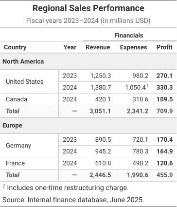

The reference table uses most of the IR: a title and subtitle, a spanner over three column labels, two row groups with labels, a stub cell spanning two rows, a summary row in each group, a footnote and a source note, and named styles (monospaced figures, a bold profit column, shaded labels).

Each tab is the real output of `gridwell convert`, and the docs' tests check
that it still is. The Preview is the HTML writer's output as it renders on this page;
the HTML tab shows its markup without the base stylesheet (`"base_styles": false`),
which the Preview has. The ANSI tab is drawn without color (`"color": false`).


::: {.callout-note collapse="true" appearance="simple"}
## The IR: `fixtures/comprehensive/reference_table.json`

<!-- gridwell file fixtures/comprehensive/reference_table.json -->
```json
{
  "ir_version": "1.0",

  "config": {
    "table_cols": 5,
    "header_rows": 2,
    "body_rows": 6,
    "stub_cols": 1,
    "row_striping": false,
    "row_striping_include_stub": true,
    "row_striping_include_body": true,
    "column_labels_hidden": false,
    "table_width": null,
    "container_width": "900px",
    "container_height": null,
    "container_overflow": "auto",
    "locale": "en-US",
    "page_break_mode": "avoid",
    "aria_label": "Regional Sales Performance table",
    "aria_describedby": null,
    "summary": "Sales revenue, expenses, and profit for North America and Europe, fiscal years 2023-2024."
  },

  "styles": {
    "defs": {
      "header_title": {
        "font_family": null,
        "font_size": "18px",
        "font_weight": "bold",
        "font_style": "normal",
        "color": "#333333",
        "background_color": null,
        "text_align": "left",
        "vertical_align": null,
        "text_transform": null,
        "text_decoration": null,
        "white_space": null,
        "padding": { "top": "4px", "right": "8px", "bottom": "0px", "left": "8px" },
        "border": null,
        "indent": null,
        "word_break": null,
        "overflow": null,
        "text_overflow": null,
        "min_width": null,
        "max_width": null
      },
      "header_subtitle": {
        "font_family": null,
        "font_size": "14px",
        "font_weight": "normal",
        "font_style": "normal",
        "color": "#666666",
        "background_color": null,
        "text_align": "left",
        "vertical_align": null,
        "text_transform": null,
        "text_decoration": null,
        "white_space": null,
        "padding": { "top": "0px", "right": "8px", "bottom": "8px", "left": "8px" },
        "border": null,
        "indent": null,
        "word_break": null,
        "overflow": null,
        "text_overflow": null,
        "min_width": null,
        "max_width": null
      },
      "spanner_label": {
        "font_family": null,
        "font_size": "13px",
        "font_weight": "bold",
        "font_style": "normal",
        "color": "#333333",
        "background_color": null,
        "text_align": "center",
        "vertical_align": "bottom",
        "text_transform": null,
        "text_decoration": null,
        "white_space": null,
        "padding": { "top": "4px", "right": "8px", "bottom": "4px", "left": "8px" },
        "border": {
          "top": null,
          "right": null,
          "bottom": { "width": "1px", "style": "solid", "color": "#A8A8A8" },
          "left": null
        },
        "indent": null,
        "word_break": null,
        "overflow": null,
        "text_overflow": null,
        "min_width": null,
        "max_width": null
      },
      "col_label": {
        "font_family": null,
        "font_size": "13px",
        "font_weight": "bold",
        "font_style": "normal",
        "color": "#333333",
        "background_color": null,
        "text_align": "center",
        "vertical_align": "bottom",
        "text_transform": null,
        "text_decoration": null,
        "white_space": null,
        "padding": { "top": "4px", "right": "8px", "bottom": "4px", "left": "8px" },
        "border": {
          "top": null,
          "right": null,
          "bottom": { "width": "2px", "style": "solid", "color": "#000000" },
          "left": null
        },
        "indent": null,
        "word_break": null,
        "overflow": null,
        "text_overflow": null,
        "min_width": null,
        "max_width": null
      },
      "col_label_stub": {
        "font_family": null,
        "font_size": "13px",
        "font_weight": "bold",
        "font_style": "normal",
        "color": "#333333",
        "background_color": null,
        "text_align": "left",
        "vertical_align": "bottom",
        "text_transform": null,
        "text_decoration": null,
        "white_space": null,
        "padding": { "top": "4px", "right": "8px", "bottom": "4px", "left": "8px" },
        "border": {
          "top": null,
          "right": null,
          "bottom": { "width": "2px", "style": "solid", "color": "#000000" },
          "left": null
        },
        "indent": null,
        "word_break": null,
        "overflow": null,
        "text_overflow": null,
        "min_width": null,
        "max_width": null
      },
      "group_label": {
        "font_family": null,
        "font_size": "13px",
        "font_weight": "bold",
        "font_style": "normal",
        "color": "#333333",
        "background_color": "#F0F0F0",
        "text_align": "left",
        "vertical_align": "middle",
        "text_transform": null,
        "text_decoration": null,
        "white_space": null,
        "padding": { "top": "6px", "right": "8px", "bottom": "6px", "left": "8px" },
        "border": {
          "top": { "width": "1px", "style": "solid", "color": "#D3D3D3" },
          "right": null,
          "bottom": { "width": "1px", "style": "solid", "color": "#D3D3D3" },
          "left": null
        },
        "indent": null,
        "word_break": null,
        "overflow": null,
        "text_overflow": null,
        "min_width": null,
        "max_width": null
      },
      "body_stub": {
        "font_family": null,
        "font_size": "13px",
        "font_weight": "normal",
        "font_style": "normal",
        "color": "#333333",
        "background_color": null,
        "text_align": "left",
        "vertical_align": "middle",
        "text_transform": null,
        "text_decoration": null,
        "white_space": null,
        "padding": { "top": "4px", "right": "8px", "bottom": "4px", "left": "12px" },
        "border": null,
        "indent": null,
        "word_break": null,
        "overflow": null,
        "text_overflow": null,
        "min_width": null,
        "max_width": null
      },
      "body_numeric": {
        "font_family": "Courier New, monospace",
        "font_size": "13px",
        "font_weight": "normal",
        "font_style": "normal",
        "color": "#333333",
        "background_color": null,
        "text_align": "right",
        "vertical_align": "middle",
        "text_transform": null,
        "text_decoration": null,
        "white_space": null,
        "padding": { "top": "4px", "right": "8px", "bottom": "4px", "left": "8px" },
        "border": null,
        "indent": null,
        "word_break": null,
        "overflow": null,
        "text_overflow": null,
        "min_width": null,
        "max_width": null
      },
      "body_profit": {
        "font_family": "Courier New, monospace",
        "font_size": "13px",
        "font_weight": "bold",
        "font_style": "normal",
        "color": "#333333",
        "background_color": null,
        "text_align": "right",
        "vertical_align": "middle",
        "text_transform": null,
        "text_decoration": null,
        "white_space": null,
        "padding": { "top": "4px", "right": "8px", "bottom": "4px", "left": "8px" },
        "border": null,
        "indent": null,
        "word_break": null,
        "overflow": null,
        "text_overflow": null,
        "min_width": null,
        "max_width": null
      },
      "body_year": {
        "font_family": null,
        "font_size": "13px",
        "font_weight": "normal",
        "font_style": "normal",
        "color": "#333333",
        "background_color": null,
        "text_align": "center",
        "vertical_align": "middle",
        "text_transform": null,
        "text_decoration": null,
        "white_space": null,
        "padding": { "top": "4px", "right": "8px", "bottom": "4px", "left": "8px" },
        "border": null,
        "indent": null,
        "word_break": null,
        "overflow": null,
        "text_overflow": null,
        "min_width": null,
        "max_width": null
      },
      "summary_label": {
        "font_family": null,
        "font_size": "13px",
        "font_weight": "bold",
        "font_style": "italic",
        "color": "#555555",
        "background_color": "#FAFAFA",
        "text_align": "left",
        "vertical_align": "middle",
        "text_transform": null,
        "text_decoration": null,
        "white_space": null,
        "padding": { "top": "4px", "right": "8px", "bottom": "4px", "left": "12px" },
        "border": {
          "top": { "width": "1px", "style": "solid", "color": "#D3D3D3" },
          "right": null,
          "bottom": null,
          "left": null
        },
        "indent": null,
        "word_break": null,
        "overflow": null,
        "text_overflow": null,
        "min_width": null,
        "max_width": null
      },
      "summary_numeric": {
        "font_family": "Courier New, monospace",
        "font_size": "13px",
        "font_weight": "bold",
        "font_style": "normal",
        "color": "#555555",
        "background_color": "#FAFAFA",
        "text_align": "right",
        "vertical_align": "middle",
        "text_transform": null,
        "text_decoration": null,
        "white_space": null,
        "padding": { "top": "4px", "right": "8px", "bottom": "4px", "left": "8px" },
        "border": {
          "top": { "width": "1px", "style": "solid", "color": "#D3D3D3" },
          "right": null,
          "bottom": null,
          "left": null
        },
        "indent": null,
        "word_break": null,
        "overflow": null,
        "text_overflow": null,
        "min_width": null,
        "max_width": null
      },
      "footnote_mark": {
        "font_family": null,
        "font_size": "10px",
        "font_weight": "normal",
        "font_style": "normal",
        "color": "#666666",
        "background_color": null,
        "text_align": null,
        "vertical_align": "super",
        "text_transform": null,
        "text_decoration": null,
        "white_space": null,
        "padding": null,
        "border": null,
        "indent": null,
        "word_break": null,
        "overflow": null,
        "text_overflow": null,
        "min_width": null,
        "max_width": null
      },
      "footer_text": {
        "font_family": null,
        "font_size": "11px",
        "font_weight": "normal",
        "font_style": "normal",
        "color": "#666666",
        "background_color": null,
        "text_align": "left",
        "vertical_align": null,
        "text_transform": null,
        "text_decoration": null,
        "white_space": null,
        "padding": { "top": "4px", "right": "8px", "bottom": "4px", "left": "8px" },
        "border": null,
        "indent": null,
        "word_break": null,
        "overflow": null,
        "text_overflow": null,
        "min_width": null,
        "max_width": null
      }
    },
    "compositions": {},
    "conditionals": []
  },

  "header": {
    "title": {
      "content": [{ "type": "text", "value": "Regional Sales Performance" }],
      "style_id": "header_title"
    },
    "subtitle": {
      "content": [{ "type": "text", "value": "Fiscal years 2023\u20132024 (in millions USD)" }],
      "style_id": "header_subtitle"
    },
    "extra_lines": [],
    "preheader_content": null
  },

  "column_spec": [
    {
      "id": "col_0",
      "align": "left",
      "align_char": null,
      "width": "auto",
      "min_width": "120px",
      "max_width": null,
      "style_id": "body_stub",
      "hidden": false,
      "label": "Country"
    },
    {
      "id": "col_1",
      "align": "center",
      "align_char": null,
      "width": "auto",
      "min_width": null,
      "max_width": null,
      "style_id": "body_year",
      "hidden": false,
      "label": "Year"
    },
    {
      "id": "col_2",
      "align": "right",
      "align_char": null,
      "width": "auto",
      "min_width": null,
      "max_width": null,
      "style_id": "body_numeric",
      "hidden": false,
      "label": "Revenue"
    },
    {
      "id": "col_3",
      "align": "right",
      "align_char": null,
      "width": "auto",
      "min_width": null,
      "max_width": null,
      "style_id": "body_numeric",
      "hidden": false,
      "label": "Expenses"
    },
    {
      "id": "col_4",
      "align": "right",
      "align_char": null,
      "width": "auto",
      "min_width": null,
      "max_width": null,
      "style_id": "body_profit",
      "hidden": false,
      "label": "Profit"
    }
  ],

  "table": {
    "thead": {
      "rows": [
        {
          "role": "spanner_label",
          "style_id": null,
          "cells": [
            {
              "content": [],
              "colspan": 1,
              "rowspan": 1,
              "style_id": "spanner_label",
              "is_stub": true,
              "is_placeholder": false,
              "scope": null
            },
            {
              "content": [],
              "colspan": 1,
              "rowspan": 1,
              "style_id": "spanner_label",
              "is_stub": false,
              "is_placeholder": false,
              "scope": null
            },
            {
              "content": [{ "type": "text", "value": "Financials" }],
              "colspan": 3,
              "rowspan": 1,
              "style_id": "spanner_label",
              "is_stub": false,
              "is_placeholder": false,
              "scope": "colgroup"
            },
            {
              "content": [],
              "colspan": 1,
              "rowspan": 1,
              "style_id": null,
              "is_stub": false,
              "is_placeholder": true,
              "scope": null
            },
            {
              "content": [],
              "colspan": 1,
              "rowspan": 1,
              "style_id": null,
              "is_stub": false,
              "is_placeholder": true,
              "scope": null
            }
          ]
        },
        {
          "role": "column_label",
          "style_id": null,
          "cells": [
            {
              "content": [{ "type": "text", "value": "Country" }],
              "colspan": 1,
              "rowspan": 1,
              "style_id": "col_label_stub",
              "is_stub": true,
              "is_placeholder": false,
              "scope": "col"
            },
            {
              "content": [{ "type": "text", "value": "Year" }],
              "colspan": 1,
              "rowspan": 1,
              "style_id": "col_label",
              "is_stub": false,
              "is_placeholder": false,
              "scope": "col"
            },
            {
              "content": [{ "type": "text", "value": "Revenue" }],
              "colspan": 1,
              "rowspan": 1,
              "style_id": "col_label",
              "is_stub": false,
              "is_placeholder": false,
              "scope": "col"
            },
            {
              "content": [{ "type": "text", "value": "Expenses" }],
              "colspan": 1,
              "rowspan": 1,
              "style_id": "col_label",
              "is_stub": false,
              "is_placeholder": false,
              "scope": "col"
            },
            {
              "content": [{ "type": "text", "value": "Profit" }],
              "colspan": 1,
              "rowspan": 1,
              "style_id": "col_label",
              "is_stub": false,
              "is_placeholder": false,
              "scope": "col"
            }
          ]
        }
      ]
    },

    "tbody": [
      {
        "group_id": "grp_north_america",
        "label": {
          "content": [{ "type": "text", "value": "North America" }],
          "style_id": "group_label",
          "colspan": null
        },
        "rows": [
          {
            "role": null,
            "style_id": null,
            "cells": [
              {
                "content": [{ "type": "text", "value": "United States" }],
                "typed_value": { "type": "string", "value": "United States" },
                "colspan": 1,
                "rowspan": 2,
                "style_id": "body_stub",
                "is_stub": true,
                "is_placeholder": false
              },
              {
                "content": [{ "type": "text", "value": "2023" }],
                "typed_value": { "type": "integer", "value": 2023 },
                "colspan": 1,
                "rowspan": 1,
                "style_id": "body_year",
                "is_stub": false,
                "is_placeholder": false
              },
              {
                "content": [{ "type": "text", "value": "1,250.3" }],
                "typed_value": { "type": "number", "value": 1250.3 },
                "colspan": 1,
                "rowspan": 1,
                "style_id": "body_numeric",
                "is_stub": false,
                "is_placeholder": false
              },
              {
                "content": [{ "type": "text", "value": "980.2" }],
                "typed_value": { "type": "number", "value": 980.2 },
                "colspan": 1,
                "rowspan": 1,
                "style_id": "body_numeric",
                "is_stub": false,
                "is_placeholder": false
              },
              {
                "content": [{ "type": "text", "value": "270.1" }],
                "typed_value": { "type": "number", "value": 270.1 },
                "colspan": 1,
                "rowspan": 1,
                "style_id": "body_profit",
                "is_stub": false,
                "is_placeholder": false
              }
            ]
          },
          {
            "role": null,
            "style_id": null,
            "cells": [
              {
                "content": [],
                "typed_value": null,
                "colspan": 1,
                "rowspan": 1,
                "style_id": null,
                "is_stub": true,
                "is_placeholder": true
              },
              {
                "content": [{ "type": "text", "value": "2024" }],
                "typed_value": { "type": "integer", "value": 2024 },
                "colspan": 1,
                "rowspan": 1,
                "style_id": "body_year",
                "is_stub": false,
                "is_placeholder": false
              },
              {
                "content": [{ "type": "text", "value": "1,380.7" }],
                "typed_value": { "type": "number", "value": 1380.7 },
                "colspan": 1,
                "rowspan": 1,
                "style_id": "body_numeric",
                "is_stub": false,
                "is_placeholder": false
              },
              {
                "content": [
                  { "type": "text", "value": "1,050.4" },
                  { "type": "footnote_mark", "ref": "fn1", "mark_text": "1" }
                ],
                "typed_value": { "type": "number", "value": 1050.4 },
                "colspan": 1,
                "rowspan": 1,
                "style_id": "body_numeric",
                "is_stub": false,
                "is_placeholder": false
              },
              {
                "content": [{ "type": "text", "value": "330.3" }],
                "typed_value": { "type": "number", "value": 330.3 },
                "colspan": 1,
                "rowspan": 1,
                "style_id": "body_profit",
                "is_stub": false,
                "is_placeholder": false
              }
            ]
          },
          {
            "role": null,
            "style_id": null,
            "cells": [
              {
                "content": [{ "type": "text", "value": "Canada" }],
                "typed_value": { "type": "string", "value": "Canada" },
                "colspan": 1,
                "rowspan": 1,
                "style_id": "body_stub",
                "is_stub": true,
                "is_placeholder": false
              },
              {
                "content": [{ "type": "text", "value": "2024" }],
                "typed_value": { "type": "integer", "value": 2024 },
                "colspan": 1,
                "rowspan": 1,
                "style_id": "body_year",
                "is_stub": false,
                "is_placeholder": false
              },
              {
                "content": [{ "type": "text", "value": "420.1" }],
                "typed_value": { "type": "number", "value": 420.1 },
                "colspan": 1,
                "rowspan": 1,
                "style_id": "body_numeric",
                "is_stub": false,
                "is_placeholder": false
              },
              {
                "content": [{ "type": "text", "value": "310.6" }],
                "typed_value": { "type": "number", "value": 310.6 },
                "colspan": 1,
                "rowspan": 1,
                "style_id": "body_numeric",
                "is_stub": false,
                "is_placeholder": false
              },
              {
                "content": [{ "type": "text", "value": "109.5" }],
                "typed_value": { "type": "number", "value": 109.5 },
                "colspan": 1,
                "rowspan": 1,
                "style_id": "body_profit",
                "is_stub": false,
                "is_placeholder": false
              }
            ]
          }
        ],
        "summary_rows": [
          {
            "role": "summary_row",
            "style_id": null,
            "cells": [
              {
                "content": [{ "type": "text", "value": "Total" }],
                "typed_value": null,
                "colspan": 1,
                "rowspan": 1,
                "style_id": "summary_label",
                "is_stub": true,
                "is_placeholder": false
              },
              {
                "content": [{ "type": "text", "value": "\u2014" }],
                "typed_value": null,
                "colspan": 1,
                "rowspan": 1,
                "style_id": "summary_numeric",
                "is_stub": false,
                "is_placeholder": false
              },
              {
                "content": [{ "type": "text", "value": "3,051.1" }],
                "typed_value": { "type": "number", "value": 3051.1 },
                "colspan": 1,
                "rowspan": 1,
                "style_id": "summary_numeric",
                "is_stub": false,
                "is_placeholder": false
              },
              {
                "content": [{ "type": "text", "value": "2,341.2" }],
                "typed_value": { "type": "number", "value": 2341.2 },
                "colspan": 1,
                "rowspan": 1,
                "style_id": "summary_numeric",
                "is_stub": false,
                "is_placeholder": false
              },
              {
                "content": [{ "type": "text", "value": "709.9" }],
                "typed_value": { "type": "number", "value": 709.9 },
                "colspan": 1,
                "rowspan": 1,
                "style_id": "summary_numeric",
                "is_stub": false,
                "is_placeholder": false
              }
            ]
          }
        ]
      },

      {
        "group_id": "grp_europe",
        "label": {
          "content": [{ "type": "text", "value": "Europe" }],
          "style_id": "group_label",
          "colspan": null
        },
        "rows": [
          {
            "role": null,
            "style_id": null,
            "cells": [
              {
                "content": [{ "type": "text", "value": "Germany" }],
                "typed_value": { "type": "string", "value": "Germany" },
                "colspan": 1,
                "rowspan": 2,
                "style_id": "body_stub",
                "is_stub": true,
                "is_placeholder": false
              },
              {
                "content": [{ "type": "text", "value": "2023" }],
                "typed_value": { "type": "integer", "value": 2023 },
                "colspan": 1,
                "rowspan": 1,
                "style_id": "body_year",
                "is_stub": false,
                "is_placeholder": false
              },
              {
                "content": [{ "type": "text", "value": "890.5" }],
                "typed_value": { "type": "number", "value": 890.5 },
                "colspan": 1,
                "rowspan": 1,
                "style_id": "body_numeric",
                "is_stub": false,
                "is_placeholder": false
              },
              {
                "content": [{ "type": "text", "value": "720.1" }],
                "typed_value": { "type": "number", "value": 720.1 },
                "colspan": 1,
                "rowspan": 1,
                "style_id": "body_numeric",
                "is_stub": false,
                "is_placeholder": false
              },
              {
                "content": [{ "type": "text", "value": "170.4" }],
                "typed_value": { "type": "number", "value": 170.4 },
                "colspan": 1,
                "rowspan": 1,
                "style_id": "body_profit",
                "is_stub": false,
                "is_placeholder": false
              }
            ]
          },
          {
            "role": null,
            "style_id": null,
            "cells": [
              {
                "content": [],
                "typed_value": null,
                "colspan": 1,
                "rowspan": 1,
                "style_id": null,
                "is_stub": true,
                "is_placeholder": true
              },
              {
                "content": [{ "type": "text", "value": "2024" }],
                "typed_value": { "type": "integer", "value": 2024 },
                "colspan": 1,
                "rowspan": 1,
                "style_id": "body_year",
                "is_stub": false,
                "is_placeholder": false
              },
              {
                "content": [{ "type": "text", "value": "945.2" }],
                "typed_value": { "type": "number", "value": 945.2 },
                "colspan": 1,
                "rowspan": 1,
                "style_id": "body_numeric",
                "is_stub": false,
                "is_placeholder": false
              },
              {
                "content": [{ "type": "text", "value": "780.3" }],
                "typed_value": { "type": "number", "value": 780.3 },
                "colspan": 1,
                "rowspan": 1,
                "style_id": "body_numeric",
                "is_stub": false,
                "is_placeholder": false
              },
              {
                "content": [{ "type": "text", "value": "164.9" }],
                "typed_value": { "type": "number", "value": 164.9 },
                "colspan": 1,
                "rowspan": 1,
                "style_id": "body_profit",
                "is_stub": false,
                "is_placeholder": false
              }
            ]
          },
          {
            "role": null,
            "style_id": null,
            "cells": [
              {
                "content": [{ "type": "text", "value": "France" }],
                "typed_value": { "type": "string", "value": "France" },
                "colspan": 1,
                "rowspan": 1,
                "style_id": "body_stub",
                "is_stub": true,
                "is_placeholder": false
              },
              {
                "content": [{ "type": "text", "value": "2024" }],
                "typed_value": { "type": "integer", "value": 2024 },
                "colspan": 1,
                "rowspan": 1,
                "style_id": "body_year",
                "is_stub": false,
                "is_placeholder": false
              },
              {
                "content": [{ "type": "text", "value": "610.8" }],
                "typed_value": { "type": "number", "value": 610.8 },
                "colspan": 1,
                "rowspan": 1,
                "style_id": "body_numeric",
                "is_stub": false,
                "is_placeholder": false
              },
              {
                "content": [{ "type": "text", "value": "490.2" }],
                "typed_value": { "type": "number", "value": 490.2 },
                "colspan": 1,
                "rowspan": 1,
                "style_id": "body_numeric",
                "is_stub": false,
                "is_placeholder": false
              },
              {
                "content": [{ "type": "text", "value": "120.6" }],
                "typed_value": { "type": "number", "value": 120.6 },
                "colspan": 1,
                "rowspan": 1,
                "style_id": "body_profit",
                "is_stub": false,
                "is_placeholder": false
              }
            ]
          }
        ],
        "summary_rows": [
          {
            "role": "summary_row",
            "style_id": null,
            "cells": [
              {
                "content": [{ "type": "text", "value": "Total" }],
                "typed_value": null,
                "colspan": 1,
                "rowspan": 1,
                "style_id": "summary_label",
                "is_stub": true,
                "is_placeholder": false
              },
              {
                "content": [{ "type": "text", "value": "\u2014" }],
                "typed_value": null,
                "colspan": 1,
                "rowspan": 1,
                "style_id": "summary_numeric",
                "is_stub": false,
                "is_placeholder": false
              },
              {
                "content": [{ "type": "text", "value": "2,446.5" }],
                "typed_value": { "type": "number", "value": 2446.5 },
                "colspan": 1,
                "rowspan": 1,
                "style_id": "summary_numeric",
                "is_stub": false,
                "is_placeholder": false
              },
              {
                "content": [{ "type": "text", "value": "1,990.6" }],
                "typed_value": { "type": "number", "value": 1990.6 },
                "colspan": 1,
                "rowspan": 1,
                "style_id": "summary_numeric",
                "is_stub": false,
                "is_placeholder": false
              },
              {
                "content": [{ "type": "text", "value": "455.9" }],
                "typed_value": { "type": "number", "value": 455.9 },
                "colspan": 1,
                "rowspan": 1,
                "style_id": "summary_numeric",
                "is_stub": false,
                "is_placeholder": false
              }
            ]
          }
        ]
      }
    ]
  },

  "footer": {
    "footnotes": [
      {
        "id": "fn1",
        "mark": "1",
        "content": [{ "type": "text", "value": "Includes one-time restructuring charge." }],
        "style_id": "footer_text"
      }
    ],
    "source_notes": [
      {
        "content": [{ "type": "text", "value": "Source: Internal finance database, June 2025." }],
        "style_id": "footer_text"
      }
    ]
  },

  "extensions": {
    "html": {
      "table_id": "regional_sales_2024",
      "table_class": "gt_table",
      "custom_css": null
    },
    "latex": {
      "environment": "table",
      "caption_position": "top"
    }
  }
}
```
:::

::: {.panel-tabset}

### Preview

<!-- gridwell convert fixtures/comprehensive/reference_table.json --to html --options '{"table_id": "comprehensive", "quarto_disable_processing": true}' -->
```{=html}
<div id="comprehensive" class="gw_container" style="max-width: 900px; overflow: auto">
  <style>
    :where(#comprehensive.gw_container) { font-family: system-ui, 'Segoe UI', Roboto, Helvetica, Arial, sans-serif; color: #333333; font-size: 16px; line-height: normal; -webkit-font-smoothing: antialiased; -moz-osx-font-smoothing: grayscale; width: fit-content; max-width: 100%; margin-left: auto; margin-right: auto }
    :where(#comprehensive .gw_title:first-of-type, #comprehensive .gw_subtitle:first-of-type, #comprehensive .gw_header_line:first-of-type) { border-top: 2px solid #A8A8A8 }
    :where(#comprehensive .gw_title) { font-size: 125%; text-align: center; padding: 4px 5px }
    :where(#comprehensive .gw_subtitle) { font-size: 85%; text-align: center; padding: 3px 5px 5px }
    :where(#comprehensive .gw_header_line) { font-size: 85%; text-align: center; padding: 0 5px 5px }
    :where(#comprehensive .gw_table) { border-collapse: collapse; margin: 0; width: 100%; border-top: 2px solid #D3D3D3; border-bottom: 2px solid #D3D3D3 }
    :where(#comprehensive .gw_cells_top) { border-top: none }
    :where(#comprehensive .gw_cells_bottom) { border-bottom: none }
    :where(#comprehensive .gw_table td, #comprehensive .gw_table th) { padding: 8px 5px; border-top: 1px solid #D3D3D3 }
    :where(#comprehensive .gw_table > tbody:first-of-type > tr:first-child > *) { border-top: none }
    :where(#comprehensive .gw_table th) { font-weight: inherit }
    :where(#comprehensive .gw_table thead th) { border-top: none; padding: 5px 5px 6px }
    :where(#comprehensive .gw_table thead tr) { vertical-align: bottom }
    :where(#comprehensive .gw_table thead) { border-bottom: 2px solid #D3D3D3 }
    :where(#comprehensive .gw_table thead:last-child) { border-bottom: none }
    :where(#comprehensive .gw_cells_head thead) { border-bottom: none }
    :where(#comprehensive .gw_spanner) { padding: 5px 4px 7px; background-image: linear-gradient(#D3D3D3, #D3D3D3); background-size: calc(100% - 8px) 2px; background-position: bottom center; background-repeat: no-repeat }
    :where(#comprehensive .gw_spanner:first-child) { padding-left: 0; background-size: calc(100% - 4px) 2px; background-position: bottom left }
    :where(#comprehensive .gw_spanner:last-child) { padding-right: 0; background-size: calc(100% - 4px) 2px; background-position: bottom right }
    :where(#comprehensive .gw_spanner:first-child:last-child) { background-size: 100% 2px }
    :where(#comprehensive .gw_group_label) { border-top: 2px solid #D3D3D3; border-bottom: 2px solid #D3D3D3 }
    :where(#comprehensive .gw_stub) { border-right: 2px solid #D3D3D3 }
    :where(#comprehensive tbody > tr.gw_summary:first-child > *, #comprehensive tr:not(.gw_summary) + tr.gw_summary > *) { border-top: 2px solid #D3D3D3 }
    :where(#comprehensive tbody > tr.gw_grand_summary:first-child:not(.gw_summary_top) > *, #comprehensive tr:not(.gw_grand_summary) + tr.gw_grand_summary:not(.gw_summary_top) > *) { border-top: 6px double #D3D3D3 }
    :where(#comprehensive tr.gw_summary_end > *) { border-bottom: 2px solid #D3D3D3 }
    :where(#comprehensive tr.gw_grand_summary.gw_summary_end > *) { border-bottom: 6px double #D3D3D3 }
    :where(#comprehensive .gw_rule_top) { border-top: 2px solid #D3D3D3 }
    :where(#comprehensive thead .gw_rule_head) { border-bottom: 2px solid #D3D3D3 }
    :where(#comprehensive tbody .gw_rule_head) { border-top: 2px solid #D3D3D3 }
    :where(#comprehensive .gw_rule_bottom) { border-bottom: 2px solid #D3D3D3 }
    :where(#comprehensive .gw_table tbody .gw__al_right) { font-variant-numeric: tabular-nums }
    :where(#comprehensive .gw_footer) { border-bottom: 2px solid #A8A8A8 }
    :where(#comprehensive .gw_footnote, #comprehensive .gw_source_note) { margin: 0; font-size: 90%; padding: 4px 5px }
    :where(#comprehensive .gw_footnote_mark) { font-size: 75%; vertical-align: 0.4em; line-height: 0; font-style: italic }
    :where(#comprehensive .gw_footnote_mark a) { color: inherit; text-decoration: none }
    #comprehensive .gw_table .gw__al_center { text-align: center }
    #comprehensive .gw_table .gw__al_left { text-align: left }
    #comprehensive .gw_table .gw__al_right { text-align: right }
    #comprehensive .gw_style-body_numeric { font-family: Courier New, monospace; font-size: 13px; font-weight: normal; font-style: normal; color: #333333; text-align: right; vertical-align: middle; padding: 4px 8px }
    #comprehensive .gw_style-body_profit { font-family: Courier New, monospace; font-size: 13px; font-weight: bold; font-style: normal; color: #333333; text-align: right; vertical-align: middle; padding: 4px 8px }
    #comprehensive .gw_style-body_stub { font-size: 13px; font-weight: normal; font-style: normal; color: #333333; text-align: left; vertical-align: middle; padding: 4px 8px 4px 12px }
    #comprehensive .gw_style-body_year { font-size: 13px; font-weight: normal; font-style: normal; color: #333333; text-align: center; vertical-align: middle; padding: 4px 8px }
    #comprehensive .gw_style-col_label { font-size: 13px; font-weight: bold; font-style: normal; color: #333333; text-align: center; vertical-align: bottom; padding: 4px 8px; border-bottom: 2px solid #000000 }
    #comprehensive .gw_style-col_label_stub { font-size: 13px; font-weight: bold; font-style: normal; color: #333333; text-align: left; vertical-align: bottom; padding: 4px 8px; border-bottom: 2px solid #000000 }
    #comprehensive .gw_style-footer_text { font-size: 11px; font-weight: normal; font-style: normal; color: #666666; text-align: left; padding: 4px 8px }
    #comprehensive .gw_style-footnote_mark { font-size: 10px; font-weight: normal; font-style: normal; color: #666666; vertical-align: super }
    #comprehensive .gw_style-group_label { font-size: 13px; font-weight: bold; font-style: normal; color: #333333; background-color: #F0F0F0; text-align: left; vertical-align: middle; padding: 6px 8px; border-top: 1px solid #D3D3D3; border-bottom: 1px solid #D3D3D3 }
    #comprehensive .gw_style-header_subtitle { font-size: 14px; font-weight: normal; font-style: normal; color: #666666; text-align: left; padding: 0 8px 8px 8px }
    #comprehensive .gw_style-header_title { font-size: 18px; font-weight: bold; font-style: normal; color: #333333; text-align: left; padding: 4px 8px 0 8px }
    #comprehensive .gw_style-spanner_label { font-size: 13px; font-weight: bold; font-style: normal; color: #333333; text-align: center; vertical-align: bottom; padding: 4px 8px; border-bottom: 1px solid #A8A8A8 }
    #comprehensive .gw_style-summary_label { font-size: 13px; font-weight: bold; font-style: italic; color: #555555; background-color: #FAFAFA; text-align: left; vertical-align: middle; padding: 4px 8px 4px 12px; border-top: 1px solid #D3D3D3 }
    #comprehensive .gw_style-summary_numeric { font-family: Courier New, monospace; font-size: 13px; font-weight: bold; font-style: normal; color: #555555; background-color: #FAFAFA; text-align: right; vertical-align: middle; padding: 4px 8px; border-top: 1px solid #D3D3D3 }
  </style>
  <div class="gw_title gw_style-header_title" id="comprehensive-title" role="heading" aria-level="1">
    Regional Sales Performance
  </div>
  <div class="gw_subtitle gw_style-header_subtitle" id="comprehensive-subtitle" role="heading" aria-level="2">
    Fiscal years 2023–2024 (in millions USD)
  </div>
  <table class="gw_table gw_cells_head" data-quarto-disable-processing="true" aria-label="Regional Sales Performance table" aria-describedby="comprehensive-subtitle">
    <caption class="gw_caption">Sales revenue, expenses, and profit for North America and Europe, fiscal years 2023-2024.</caption>
    <thead>
      <tr class="gw_spanners">
        <th class="gw_stubhead gw__al_center gw_style-spanner_label"></th>
        <th class="gw__al_center gw_style-spanner_label"></th>
        <th class="gw_spanner gw__al_center gw_style-spanner_label" scope="colgroup" colspan="3" id="comprehensive-Financials">Financials</th>
      </tr>
      <tr class="gw_col_labels">
        <th class="gw_stubhead gw__al_left gw_style-col_label_stub" scope="col" id="comprehensive-Country">Country</th>
        <th class="gw_col_label gw__al_center gw_style-col_label" scope="col" id="comprehensive-col_1">Year</th>
        <th class="gw_col_label gw__al_center gw_style-col_label" scope="col" id="comprehensive-col_2">Revenue</th>
        <th class="gw_col_label gw__al_center gw_style-col_label" scope="col" id="comprehensive-col_3">Expenses</th>
        <th class="gw_col_label gw__al_center gw_style-col_label" scope="col" id="comprehensive-col_4">Profit</th>
      </tr>
    </thead>
    <tbody>
      <tr>
        <th colspan="5" scope="colgroup" class="gw_group_label gw__al_left gw_style-group_label" id="comprehensive-grp_north_america">
          North America
        </th>
      </tr>
      <tr>
        <th class="gw_stub gw__al_left gw_style-body_stub" scope="rowgroup" rowspan="2" id="comprehensive-stub-1">United States</th>
        <td class="gw__al_center gw_style-body_year" headers="comprehensive-grp_north_america comprehensive-stub-1 comprehensive-col_1">2023</td>
        <td class="gw__al_right gw_style-body_numeric" headers="comprehensive-grp_north_america comprehensive-stub-1 comprehensive-Financials comprehensive-col_2">1,250.3</td>
        <td class="gw__al_right gw_style-body_numeric" headers="comprehensive-grp_north_america comprehensive-stub-1 comprehensive-Financials comprehensive-col_3">980.2</td>
        <td class="gw__al_right gw_style-body_profit" headers="comprehensive-grp_north_america comprehensive-stub-1 comprehensive-Financials comprehensive-col_4">270.1</td>
      </tr>
      <tr>
        <td class="gw__al_center gw_style-body_year" headers="comprehensive-grp_north_america comprehensive-stub-1 comprehensive-col_1">2024</td>
        <td class="gw__al_right gw_style-body_numeric" headers="comprehensive-grp_north_america comprehensive-stub-1 comprehensive-Financials comprehensive-col_2">1,380.7</td>
        <td class="gw__al_right gw_style-body_numeric" headers="comprehensive-grp_north_america comprehensive-stub-1 comprehensive-Financials comprehensive-col_3">
          1,050.4<sup class="gw_footnote_mark"><a href="#fn1">1</a></sup>
        </td>
        <td class="gw__al_right gw_style-body_profit" headers="comprehensive-grp_north_america comprehensive-stub-1 comprehensive-Financials comprehensive-col_4">330.3</td>
      </tr>
      <tr>
        <th class="gw_stub gw__al_left gw_style-body_stub" scope="row" id="comprehensive-stub-3">Canada</th>
        <td class="gw__al_center gw_style-body_year" headers="comprehensive-grp_north_america comprehensive-stub-3 comprehensive-col_1">2024</td>
        <td class="gw__al_right gw_style-body_numeric" headers="comprehensive-grp_north_america comprehensive-stub-3 comprehensive-Financials comprehensive-col_2">420.1</td>
        <td class="gw__al_right gw_style-body_numeric" headers="comprehensive-grp_north_america comprehensive-stub-3 comprehensive-Financials comprehensive-col_3">310.6</td>
        <td class="gw__al_right gw_style-body_profit" headers="comprehensive-grp_north_america comprehensive-stub-3 comprehensive-Financials comprehensive-col_4">109.5</td>
      </tr>
      <tr class="gw_summary">
        <th class="gw_stub gw__al_left gw_style-summary_label" scope="row" id="comprehensive-summary-grp_north_america-Total">Total</th>
        <td class="gw__al_right gw_style-summary_numeric" headers="comprehensive-grp_north_america comprehensive-summary-grp_north_america-Total comprehensive-col_1">—</td>
        <td class="gw__al_right gw_style-summary_numeric" headers="comprehensive-grp_north_america comprehensive-summary-grp_north_america-Total comprehensive-Financials comprehensive-col_2">3,051.1</td>
        <td class="gw__al_right gw_style-summary_numeric" headers="comprehensive-grp_north_america comprehensive-summary-grp_north_america-Total comprehensive-Financials comprehensive-col_3">2,341.2</td>
        <td class="gw__al_right gw_style-summary_numeric" headers="comprehensive-grp_north_america comprehensive-summary-grp_north_america-Total comprehensive-Financials comprehensive-col_4">709.9</td>
      </tr>
    </tbody>
    <tbody>
      <tr>
        <th colspan="5" scope="colgroup" class="gw_group_label gw__al_left gw_style-group_label" id="comprehensive-grp_europe">
          Europe
        </th>
      </tr>
      <tr>
        <th class="gw_stub gw__al_left gw_style-body_stub" scope="rowgroup" rowspan="2" id="comprehensive-stub-4">Germany</th>
        <td class="gw__al_center gw_style-body_year" headers="comprehensive-grp_europe comprehensive-stub-4 comprehensive-col_1">2023</td>
        <td class="gw__al_right gw_style-body_numeric" headers="comprehensive-grp_europe comprehensive-stub-4 comprehensive-Financials comprehensive-col_2">890.5</td>
        <td class="gw__al_right gw_style-body_numeric" headers="comprehensive-grp_europe comprehensive-stub-4 comprehensive-Financials comprehensive-col_3">720.1</td>
        <td class="gw__al_right gw_style-body_profit" headers="comprehensive-grp_europe comprehensive-stub-4 comprehensive-Financials comprehensive-col_4">170.4</td>
      </tr>
      <tr>
        <td class="gw__al_center gw_style-body_year" headers="comprehensive-grp_europe comprehensive-stub-4 comprehensive-col_1">2024</td>
        <td class="gw__al_right gw_style-body_numeric" headers="comprehensive-grp_europe comprehensive-stub-4 comprehensive-Financials comprehensive-col_2">945.2</td>
        <td class="gw__al_right gw_style-body_numeric" headers="comprehensive-grp_europe comprehensive-stub-4 comprehensive-Financials comprehensive-col_3">780.3</td>
        <td class="gw__al_right gw_style-body_profit" headers="comprehensive-grp_europe comprehensive-stub-4 comprehensive-Financials comprehensive-col_4">164.9</td>
      </tr>
      <tr>
        <th class="gw_stub gw__al_left gw_style-body_stub" scope="row" id="comprehensive-stub-6">France</th>
        <td class="gw__al_center gw_style-body_year" headers="comprehensive-grp_europe comprehensive-stub-6 comprehensive-col_1">2024</td>
        <td class="gw__al_right gw_style-body_numeric" headers="comprehensive-grp_europe comprehensive-stub-6 comprehensive-Financials comprehensive-col_2">610.8</td>
        <td class="gw__al_right gw_style-body_numeric" headers="comprehensive-grp_europe comprehensive-stub-6 comprehensive-Financials comprehensive-col_3">490.2</td>
        <td class="gw__al_right gw_style-body_profit" headers="comprehensive-grp_europe comprehensive-stub-6 comprehensive-Financials comprehensive-col_4">120.6</td>
      </tr>
      <tr class="gw_summary">
        <th class="gw_stub gw__al_left gw_style-summary_label" scope="row" id="comprehensive-summary-grp_europe-Total">Total</th>
        <td class="gw__al_right gw_style-summary_numeric" headers="comprehensive-grp_europe comprehensive-summary-grp_europe-Total comprehensive-col_1">—</td>
        <td class="gw__al_right gw_style-summary_numeric" headers="comprehensive-grp_europe comprehensive-summary-grp_europe-Total comprehensive-Financials comprehensive-col_2">2,446.5</td>
        <td class="gw__al_right gw_style-summary_numeric" headers="comprehensive-grp_europe comprehensive-summary-grp_europe-Total comprehensive-Financials comprehensive-col_3">1,990.6</td>
        <td class="gw__al_right gw_style-summary_numeric" headers="comprehensive-grp_europe comprehensive-summary-grp_europe-Total comprehensive-Financials comprehensive-col_4">455.9</td>
      </tr>
    </tbody>
  </table>
  <div class="gw_footer">
    <div class="gw_footnotes">
      <p id="fn1" class="gw_footnote gw_style-footer_text">
        <sup class="gw_footnote_mark">1</sup> Includes one-time restructuring charge.
      </p>
    </div>
    <div class="gw_source_notes">
      <p class="gw_source_note gw_style-footer_text">
        Source: Internal finance database, June 2025.
      </p>
    </div>
  </div>
</div>
```

### HTML

<!-- gridwell convert fixtures/comprehensive/reference_table.json --to html --options '{"base_styles": false}' -->
```html
<div class="gw_container" style="max-width: 900px; overflow: auto">
  <style>
    .gw_table .gw__al_center { text-align: center }
    .gw_table .gw__al_left { text-align: left }
    .gw_table .gw__al_right { text-align: right }
    .gw_style-body_numeric { font-family: Courier New, monospace; font-size: 13px; font-weight: normal; font-style: normal; color: #333333; text-align: right; vertical-align: middle; padding: 4px 8px }
    .gw_style-body_profit { font-family: Courier New, monospace; font-size: 13px; font-weight: bold; font-style: normal; color: #333333; text-align: right; vertical-align: middle; padding: 4px 8px }
    .gw_style-body_stub { font-size: 13px; font-weight: normal; font-style: normal; color: #333333; text-align: left; vertical-align: middle; padding: 4px 8px 4px 12px }
    .gw_style-body_year { font-size: 13px; font-weight: normal; font-style: normal; color: #333333; text-align: center; vertical-align: middle; padding: 4px 8px }
    .gw_style-col_label { font-size: 13px; font-weight: bold; font-style: normal; color: #333333; text-align: center; vertical-align: bottom; padding: 4px 8px; border-bottom: 2px solid #000000 }
    .gw_style-col_label_stub { font-size: 13px; font-weight: bold; font-style: normal; color: #333333; text-align: left; vertical-align: bottom; padding: 4px 8px; border-bottom: 2px solid #000000 }
    .gw_style-footer_text { font-size: 11px; font-weight: normal; font-style: normal; color: #666666; text-align: left; padding: 4px 8px }
    .gw_style-footnote_mark { font-size: 10px; font-weight: normal; font-style: normal; color: #666666; vertical-align: super }
    .gw_style-group_label { font-size: 13px; font-weight: bold; font-style: normal; color: #333333; background-color: #F0F0F0; text-align: left; vertical-align: middle; padding: 6px 8px; border-top: 1px solid #D3D3D3; border-bottom: 1px solid #D3D3D3 }
    .gw_style-header_subtitle { font-size: 14px; font-weight: normal; font-style: normal; color: #666666; text-align: left; padding: 0 8px 8px 8px }
    .gw_style-header_title { font-size: 18px; font-weight: bold; font-style: normal; color: #333333; text-align: left; padding: 4px 8px 0 8px }
    .gw_style-spanner_label { font-size: 13px; font-weight: bold; font-style: normal; color: #333333; text-align: center; vertical-align: bottom; padding: 4px 8px; border-bottom: 1px solid #A8A8A8 }
    .gw_style-summary_label { font-size: 13px; font-weight: bold; font-style: italic; color: #555555; background-color: #FAFAFA; text-align: left; vertical-align: middle; padding: 4px 8px 4px 12px; border-top: 1px solid #D3D3D3 }
    .gw_style-summary_numeric { font-family: Courier New, monospace; font-size: 13px; font-weight: bold; font-style: normal; color: #555555; background-color: #FAFAFA; text-align: right; vertical-align: middle; padding: 4px 8px; border-top: 1px solid #D3D3D3 }
  </style>
  <div class="gw_title gw_style-header_title" id="title" role="heading" aria-level="1">
    Regional Sales Performance
  </div>
  <div class="gw_subtitle gw_style-header_subtitle" id="subtitle" role="heading" aria-level="2">
    Fiscal years 2023–2024 (in millions USD)
  </div>
  <table class="gw_table gw_cells_head" aria-label="Regional Sales Performance table" aria-describedby="subtitle">
    <caption class="gw_caption">Sales revenue, expenses, and profit for North America and Europe, fiscal years 2023-2024.</caption>
    <thead>
      <tr class="gw_spanners">
        <th class="gw_stubhead gw__al_center gw_style-spanner_label"></th>
        <th class="gw__al_center gw_style-spanner_label"></th>
        <th class="gw_spanner gw__al_center gw_style-spanner_label" scope="colgroup" colspan="3" id="Financials">Financials</th>
      </tr>
      <tr class="gw_col_labels">
        <th class="gw_stubhead gw__al_left gw_style-col_label_stub" scope="col" id="Country">Country</th>
        <th class="gw_col_label gw__al_center gw_style-col_label" scope="col" id="col_1">Year</th>
        <th class="gw_col_label gw__al_center gw_style-col_label" scope="col" id="col_2">Revenue</th>
        <th class="gw_col_label gw__al_center gw_style-col_label" scope="col" id="col_3">Expenses</th>
        <th class="gw_col_label gw__al_center gw_style-col_label" scope="col" id="col_4">Profit</th>
      </tr>
    </thead>
    <tbody>
      <tr>
        <th colspan="5" scope="colgroup" class="gw_group_label gw__al_left gw_style-group_label" id="grp_north_america">
          North America
        </th>
      </tr>
      <tr>
        <th class="gw_stub gw__al_left gw_style-body_stub" scope="rowgroup" rowspan="2" id="stub-1">United States</th>
        <td class="gw__al_center gw_style-body_year" headers="grp_north_america stub-1 col_1">2023</td>
        <td class="gw__al_right gw_style-body_numeric" headers="grp_north_america stub-1 Financials col_2">1,250.3</td>
        <td class="gw__al_right gw_style-body_numeric" headers="grp_north_america stub-1 Financials col_3">980.2</td>
        <td class="gw__al_right gw_style-body_profit" headers="grp_north_america stub-1 Financials col_4">270.1</td>
      </tr>
      <tr>
        <td class="gw__al_center gw_style-body_year" headers="grp_north_america stub-1 col_1">2024</td>
        <td class="gw__al_right gw_style-body_numeric" headers="grp_north_america stub-1 Financials col_2">1,380.7</td>
        <td class="gw__al_right gw_style-body_numeric" headers="grp_north_america stub-1 Financials col_3">
          1,050.4<sup class="gw_footnote_mark"><a href="#fn1">1</a></sup>
        </td>
        <td class="gw__al_right gw_style-body_profit" headers="grp_north_america stub-1 Financials col_4">330.3</td>
      </tr>
      <tr>
        <th class="gw_stub gw__al_left gw_style-body_stub" scope="row" id="stub-3">Canada</th>
        <td class="gw__al_center gw_style-body_year" headers="grp_north_america stub-3 col_1">2024</td>
        <td class="gw__al_right gw_style-body_numeric" headers="grp_north_america stub-3 Financials col_2">420.1</td>
        <td class="gw__al_right gw_style-body_numeric" headers="grp_north_america stub-3 Financials col_3">310.6</td>
        <td class="gw__al_right gw_style-body_profit" headers="grp_north_america stub-3 Financials col_4">109.5</td>
      </tr>
      <tr class="gw_summary">
        <th class="gw_stub gw__al_left gw_style-summary_label" scope="row" id="summary-grp_north_america-Total">Total</th>
        <td class="gw__al_right gw_style-summary_numeric" headers="grp_north_america summary-grp_north_america-Total col_1">—</td>
        <td class="gw__al_right gw_style-summary_numeric" headers="grp_north_america summary-grp_north_america-Total Financials col_2">3,051.1</td>
        <td class="gw__al_right gw_style-summary_numeric" headers="grp_north_america summary-grp_north_america-Total Financials col_3">2,341.2</td>
        <td class="gw__al_right gw_style-summary_numeric" headers="grp_north_america summary-grp_north_america-Total Financials col_4">709.9</td>
      </tr>
    </tbody>
    <tbody>
      <tr>
        <th colspan="5" scope="colgroup" class="gw_group_label gw__al_left gw_style-group_label" id="grp_europe">
          Europe
        </th>
      </tr>
      <tr>
        <th class="gw_stub gw__al_left gw_style-body_stub" scope="rowgroup" rowspan="2" id="stub-4">Germany</th>
        <td class="gw__al_center gw_style-body_year" headers="grp_europe stub-4 col_1">2023</td>
        <td class="gw__al_right gw_style-body_numeric" headers="grp_europe stub-4 Financials col_2">890.5</td>
        <td class="gw__al_right gw_style-body_numeric" headers="grp_europe stub-4 Financials col_3">720.1</td>
        <td class="gw__al_right gw_style-body_profit" headers="grp_europe stub-4 Financials col_4">170.4</td>
      </tr>
      <tr>
        <td class="gw__al_center gw_style-body_year" headers="grp_europe stub-4 col_1">2024</td>
        <td class="gw__al_right gw_style-body_numeric" headers="grp_europe stub-4 Financials col_2">945.2</td>
        <td class="gw__al_right gw_style-body_numeric" headers="grp_europe stub-4 Financials col_3">780.3</td>
        <td class="gw__al_right gw_style-body_profit" headers="grp_europe stub-4 Financials col_4">164.9</td>
      </tr>
      <tr>
        <th class="gw_stub gw__al_left gw_style-body_stub" scope="row" id="stub-6">France</th>
        <td class="gw__al_center gw_style-body_year" headers="grp_europe stub-6 col_1">2024</td>
        <td class="gw__al_right gw_style-body_numeric" headers="grp_europe stub-6 Financials col_2">610.8</td>
        <td class="gw__al_right gw_style-body_numeric" headers="grp_europe stub-6 Financials col_3">490.2</td>
        <td class="gw__al_right gw_style-body_profit" headers="grp_europe stub-6 Financials col_4">120.6</td>
      </tr>
      <tr class="gw_summary">
        <th class="gw_stub gw__al_left gw_style-summary_label" scope="row" id="summary-grp_europe-Total">Total</th>
        <td class="gw__al_right gw_style-summary_numeric" headers="grp_europe summary-grp_europe-Total col_1">—</td>
        <td class="gw__al_right gw_style-summary_numeric" headers="grp_europe summary-grp_europe-Total Financials col_2">2,446.5</td>
        <td class="gw__al_right gw_style-summary_numeric" headers="grp_europe summary-grp_europe-Total Financials col_3">1,990.6</td>
        <td class="gw__al_right gw_style-summary_numeric" headers="grp_europe summary-grp_europe-Total Financials col_4">455.9</td>
      </tr>
    </tbody>
  </table>
  <div class="gw_footer">
    <div class="gw_footnotes">
      <p id="fn1" class="gw_footnote gw_style-footer_text">
        <sup class="gw_footnote_mark">1</sup> Includes one-time restructuring charge.
      </p>
    </div>
    <div class="gw_source_notes">
      <p class="gw_source_note gw_style-footer_text">
        Source: Internal finance database, June 2025.
      </p>
    </div>
  </div>
</div>
```

### LaTeX

<!-- gridwell convert fixtures/comprehensive/reference_table.json --to latex -->
```latex
{\large\bfseries {\fontsize{13.5}{16.2}\selectfont \textcolor[HTML]{333333}{\textup{\textbf{Regional Sales Performance}}}}}\\
{\small {\fontsize{10.5}{12.6}\selectfont \textcolor[HTML]{666666}{\textup{\textmd{Fiscal years 2023–2024 (in millions USD)}}}}}\\[6pt]
\begin{tabular}{lcrrr}
\toprule
\multicolumn{1}{c}{{\fontsize{9.75}{11.7}\selectfont \textcolor[HTML]{333333}{\textup{\textbf{}}}}} & {\fontsize{9.75}{11.7}\selectfont \textcolor[HTML]{333333}{\textup{\textbf{}}}} & \multicolumn{3}{c}{{\fontsize{9.75}{11.7}\selectfont \textcolor[HTML]{333333}{\textup{\textbf{Financials}}}}} \\
\multispan{5}{\color[HTML]{A8A8A8}\leaders\hrule height 0.75pt\hfill}\cr
\cmidrule(lr){3-5}
{\fontsize{9.75}{11.7}\selectfont \textcolor[HTML]{333333}{\textup{\textbf{Country}}}} & {\fontsize{9.75}{11.7}\selectfont \textcolor[HTML]{333333}{\textup{\textbf{Year}}}} & \multicolumn{1}{c}{{\fontsize{9.75}{11.7}\selectfont \textcolor[HTML]{333333}{\textup{\textbf{Revenue}}}}} & \multicolumn{1}{c}{{\fontsize{9.75}{11.7}\selectfont \textcolor[HTML]{333333}{\textup{\textbf{Expenses}}}}} & \multicolumn{1}{c}{{\fontsize{9.75}{11.7}\selectfont \textcolor[HTML]{333333}{\textup{\textbf{Profit}}}}} \\
\multispan{5}{\color[HTML]{000000}\leaders\hrule height 1.5pt\hfill}\cr
\midrule
\multispan{5}{\color[HTML]{D3D3D3}\leaders\hrule height 0.75pt\hfill}\cr
\multicolumn{5}{l}{\bfseries \cellcolor[HTML]{F0F0F0}{\fontsize{9.75}{11.7}\selectfont \textcolor[HTML]{333333}{\textup{\textbf{North America}}}}} \\
\multispan{5}{\color[HTML]{D3D3D3}\leaders\hrule height 0.75pt\hfill}\cr
\midrule
\multirow{2}{*}{{\fontsize{9.75}{11.7}\selectfont \textcolor[HTML]{333333}{\textup{\textmd{United States}}}}} & {\fontsize{9.75}{11.7}\selectfont \textcolor[HTML]{333333}{\textup{\textmd{2023}}}} & \texttt{{\fontsize{9.75}{11.7}\selectfont \textcolor[HTML]{333333}{\textup{\textmd{1,250.3}}}}} & \texttt{{\fontsize{9.75}{11.7}\selectfont \textcolor[HTML]{333333}{\textup{\textmd{980.2}}}}} & \texttt{{\fontsize{9.75}{11.7}\selectfont \textcolor[HTML]{333333}{\textup{\textbf{270.1}}}}} \\
 & {\fontsize{9.75}{11.7}\selectfont \textcolor[HTML]{333333}{\textup{\textmd{2024}}}} & \texttt{{\fontsize{9.75}{11.7}\selectfont \textcolor[HTML]{333333}{\textup{\textmd{1,380.7}}}}} & \texttt{{\fontsize{9.75}{11.7}\selectfont \textcolor[HTML]{333333}{\textup{\textmd{1,050.4\textsuperscript{1}}}}}} & \texttt{{\fontsize{9.75}{11.7}\selectfont \textcolor[HTML]{333333}{\textup{\textbf{330.3}}}}} \\
{\fontsize{9.75}{11.7}\selectfont \textcolor[HTML]{333333}{\textup{\textmd{Canada}}}} & {\fontsize{9.75}{11.7}\selectfont \textcolor[HTML]{333333}{\textup{\textmd{2024}}}} & \texttt{{\fontsize{9.75}{11.7}\selectfont \textcolor[HTML]{333333}{\textup{\textmd{420.1}}}}} & \texttt{{\fontsize{9.75}{11.7}\selectfont \textcolor[HTML]{333333}{\textup{\textmd{310.6}}}}} & \texttt{{\fontsize{9.75}{11.7}\selectfont \textcolor[HTML]{333333}{\textup{\textbf{109.5}}}}} \\
\cmidrule(lr){1-5}
\multispan{5}{\color[HTML]{D3D3D3}\leaders\hrule height 0.75pt\hfill}\cr
\cellcolor[HTML]{FAFAFA}{\fontsize{9.75}{11.7}\selectfont \textcolor[HTML]{555555}{\textit{\textbf{Total}}}} & \multicolumn{1}{r}{\cellcolor[HTML]{FAFAFA}\texttt{{\fontsize{9.75}{11.7}\selectfont \textcolor[HTML]{555555}{\textup{\textbf{—}}}}}} & \cellcolor[HTML]{FAFAFA}\texttt{{\fontsize{9.75}{11.7}\selectfont \textcolor[HTML]{555555}{\textup{\textbf{3,051.1}}}}} & \cellcolor[HTML]{FAFAFA}\texttt{{\fontsize{9.75}{11.7}\selectfont \textcolor[HTML]{555555}{\textup{\textbf{2,341.2}}}}} & \cellcolor[HTML]{FAFAFA}\texttt{{\fontsize{9.75}{11.7}\selectfont \textcolor[HTML]{555555}{\textup{\textbf{709.9}}}}} \\
\midrule
\multispan{5}{\color[HTML]{D3D3D3}\leaders\hrule height 0.75pt\hfill}\cr
\multicolumn{5}{l}{\bfseries \cellcolor[HTML]{F0F0F0}{\fontsize{9.75}{11.7}\selectfont \textcolor[HTML]{333333}{\textup{\textbf{Europe}}}}} \\
\multispan{5}{\color[HTML]{D3D3D3}\leaders\hrule height 0.75pt\hfill}\cr
\midrule
\multirow{2}{*}{{\fontsize{9.75}{11.7}\selectfont \textcolor[HTML]{333333}{\textup{\textmd{Germany}}}}} & {\fontsize{9.75}{11.7}\selectfont \textcolor[HTML]{333333}{\textup{\textmd{2023}}}} & \texttt{{\fontsize{9.75}{11.7}\selectfont \textcolor[HTML]{333333}{\textup{\textmd{890.5}}}}} & \texttt{{\fontsize{9.75}{11.7}\selectfont \textcolor[HTML]{333333}{\textup{\textmd{720.1}}}}} & \texttt{{\fontsize{9.75}{11.7}\selectfont \textcolor[HTML]{333333}{\textup{\textbf{170.4}}}}} \\
 & {\fontsize{9.75}{11.7}\selectfont \textcolor[HTML]{333333}{\textup{\textmd{2024}}}} & \texttt{{\fontsize{9.75}{11.7}\selectfont \textcolor[HTML]{333333}{\textup{\textmd{945.2}}}}} & \texttt{{\fontsize{9.75}{11.7}\selectfont \textcolor[HTML]{333333}{\textup{\textmd{780.3}}}}} & \texttt{{\fontsize{9.75}{11.7}\selectfont \textcolor[HTML]{333333}{\textup{\textbf{164.9}}}}} \\
{\fontsize{9.75}{11.7}\selectfont \textcolor[HTML]{333333}{\textup{\textmd{France}}}} & {\fontsize{9.75}{11.7}\selectfont \textcolor[HTML]{333333}{\textup{\textmd{2024}}}} & \texttt{{\fontsize{9.75}{11.7}\selectfont \textcolor[HTML]{333333}{\textup{\textmd{610.8}}}}} & \texttt{{\fontsize{9.75}{11.7}\selectfont \textcolor[HTML]{333333}{\textup{\textmd{490.2}}}}} & \texttt{{\fontsize{9.75}{11.7}\selectfont \textcolor[HTML]{333333}{\textup{\textbf{120.6}}}}} \\
\cmidrule(lr){1-5}
\multispan{5}{\color[HTML]{D3D3D3}\leaders\hrule height 0.75pt\hfill}\cr
\cellcolor[HTML]{FAFAFA}{\fontsize{9.75}{11.7}\selectfont \textcolor[HTML]{555555}{\textit{\textbf{Total}}}} & \multicolumn{1}{r}{\cellcolor[HTML]{FAFAFA}\texttt{{\fontsize{9.75}{11.7}\selectfont \textcolor[HTML]{555555}{\textup{\textbf{—}}}}}} & \cellcolor[HTML]{FAFAFA}\texttt{{\fontsize{9.75}{11.7}\selectfont \textcolor[HTML]{555555}{\textup{\textbf{2,446.5}}}}} & \cellcolor[HTML]{FAFAFA}\texttt{{\fontsize{9.75}{11.7}\selectfont \textcolor[HTML]{555555}{\textup{\textbf{1,990.6}}}}} & \cellcolor[HTML]{FAFAFA}\texttt{{\fontsize{9.75}{11.7}\selectfont \textcolor[HTML]{555555}{\textup{\textbf{455.9}}}}} \\
\bottomrule
\end{tabular}

\textsuperscript{1} {\fontsize{8.25}{9.9}\selectfont \textcolor[HTML]{666666}{\textup{\textmd{Includes one-time restructuring charge.}}}}\\

{\footnotesize {\fontsize{8.25}{9.9}\selectfont \textcolor[HTML]{666666}{\textup{\textmd{Source: Internal finance database, June 2025.}}}}}\\
```

### Typst

<!-- gridwell convert fixtures/comprehensive/reference_table.json --to typst -->
```typst
#align(left)[#text(weight: "bold", style: "normal", size: 13.5pt, fill: rgb("#333333"))[Regional Sales Performance]]
#align(left)[#text(weight: "regular", style: "normal", size: 10.5pt, fill: rgb("#666666"))[Fiscal years 2023–2024 \(in millions USD\)]]
#v(6pt)
#table(
  columns: (auto, auto, auto, auto, auto,),
  align: (left, center, right, right, right,),
  stroke: none,
  table.header(
    table.cell(stroke: (bottom: (thickness: 0.75pt, paint: rgb("#A8A8A8"))), align: center + bottom)[],
    table.cell(stroke: (bottom: (thickness: 0.75pt, paint: rgb("#A8A8A8"))), align: center + bottom)[],
    table.cell(colspan: 3, stroke: (bottom: (thickness: 0.75pt, paint: rgb("#A8A8A8"))), align: center + bottom)[#text(weight: "bold", style: "normal", size: 9.75pt, fill: rgb("#333333"))[Financials]],
    table.cell(stroke: (bottom: (thickness: 1.5pt, paint: rgb("#000000"))), align: left + bottom)[#text(weight: "bold", style: "normal", size: 9.75pt, fill: rgb("#333333"))[Country]],
    table.cell(stroke: (bottom: (thickness: 1.5pt, paint: rgb("#000000"))), align: center + bottom)[#text(weight: "bold", style: "normal", size: 9.75pt, fill: rgb("#333333"))[Year]],
    table.cell(stroke: (bottom: (thickness: 1.5pt, paint: rgb("#000000"))), align: center + bottom)[#text(weight: "bold", style: "normal", size: 9.75pt, fill: rgb("#333333"))[Revenue]],
    table.cell(stroke: (bottom: (thickness: 1.5pt, paint: rgb("#000000"))), align: center + bottom)[#text(weight: "bold", style: "normal", size: 9.75pt, fill: rgb("#333333"))[Expenses]],
    table.cell(stroke: (bottom: (thickness: 1.5pt, paint: rgb("#000000"))), align: center + bottom)[#text(weight: "bold", style: "normal", size: 9.75pt, fill: rgb("#333333"))[Profit]],
    table.hline(stroke: 0.5pt),
  ),
  table.hline(stroke: 0.5pt),
  table.cell(colspan: 5, fill: rgb("#F0F0F0"), stroke: (top: (thickness: 0.75pt, paint: rgb("#D3D3D3")), bottom: (thickness: 0.75pt, paint: rgb("#D3D3D3"))))[#text(weight: "bold", style: "normal", size: 9.75pt, fill: rgb("#333333"))[North America]],
  table.hline(stroke: 0.5pt),
  table.cell(rowspan: 2, align: left + horizon)[#text(weight: "regular", style: "normal", size: 9.75pt, fill: rgb("#333333"))[United States]],
  table.cell(align: center + horizon)[#text(weight: "regular", style: "normal", size: 9.75pt, fill: rgb("#333333"))[2023]],
  table.cell(align: right + horizon)[#text(weight: "regular", style: "normal", size: 9.75pt, fill: rgb("#333333"), font: "Courier New")[1\,250\.3]],
  table.cell(align: right + horizon)[#text(weight: "regular", style: "normal", size: 9.75pt, fill: rgb("#333333"), font: "Courier New")[980\.2]],
  table.cell(align: right + horizon)[#text(weight: "bold", style: "normal", size: 9.75pt, fill: rgb("#333333"), font: "Courier New")[270\.1]],
  table.cell(align: center + horizon)[#text(weight: "regular", style: "normal", size: 9.75pt, fill: rgb("#333333"))[2024]],
  table.cell(align: right + horizon)[#text(weight: "regular", style: "normal", size: 9.75pt, fill: rgb("#333333"), font: "Courier New")[1\,380\.7]],
  table.cell(align: right + horizon)[#text(weight: "regular", style: "normal", size: 9.75pt, fill: rgb("#333333"), font: "Courier New")[1\,050\.4#super[1]]],
  table.cell(align: right + horizon)[#text(weight: "bold", style: "normal", size: 9.75pt, fill: rgb("#333333"), font: "Courier New")[330\.3]],
  table.cell(align: left + horizon)[#text(weight: "regular", style: "normal", size: 9.75pt, fill: rgb("#333333"))[Canada]],
  table.cell(align: center + horizon)[#text(weight: "regular", style: "normal", size: 9.75pt, fill: rgb("#333333"))[2024]],
  table.cell(align: right + horizon)[#text(weight: "regular", style: "normal", size: 9.75pt, fill: rgb("#333333"), font: "Courier New")[420\.1]],
  table.cell(align: right + horizon)[#text(weight: "regular", style: "normal", size: 9.75pt, fill: rgb("#333333"), font: "Courier New")[310\.6]],
  table.cell(align: right + horizon)[#text(weight: "bold", style: "normal", size: 9.75pt, fill: rgb("#333333"), font: "Courier New")[109\.5]],
  table.hline(stroke: 0.3pt),
  table.cell(fill: rgb("#FAFAFA"), stroke: (top: (thickness: 0.75pt, paint: rgb("#D3D3D3"))), align: left + horizon)[#text(weight: "bold", style: "italic", size: 9.75pt, fill: rgb("#555555"))[Total]],
  table.cell(fill: rgb("#FAFAFA"), stroke: (top: (thickness: 0.75pt, paint: rgb("#D3D3D3"))), align: right + horizon)[#text(weight: "bold", style: "normal", size: 9.75pt, fill: rgb("#555555"), font: "Courier New")[—]],
  table.cell(fill: rgb("#FAFAFA"), stroke: (top: (thickness: 0.75pt, paint: rgb("#D3D3D3"))), align: right + horizon)[#text(weight: "bold", style: "normal", size: 9.75pt, fill: rgb("#555555"), font: "Courier New")[3\,051\.1]],
  table.cell(fill: rgb("#FAFAFA"), stroke: (top: (thickness: 0.75pt, paint: rgb("#D3D3D3"))), align: right + horizon)[#text(weight: "bold", style: "normal", size: 9.75pt, fill: rgb("#555555"), font: "Courier New")[2\,341\.2]],
  table.cell(fill: rgb("#FAFAFA"), stroke: (top: (thickness: 0.75pt, paint: rgb("#D3D3D3"))), align: right + horizon)[#text(weight: "bold", style: "normal", size: 9.75pt, fill: rgb("#555555"), font: "Courier New")[709\.9]],
  table.hline(stroke: 0.3pt),
  table.hline(stroke: 0.5pt),
  table.cell(colspan: 5, fill: rgb("#F0F0F0"), stroke: (top: (thickness: 0.75pt, paint: rgb("#D3D3D3")), bottom: (thickness: 0.75pt, paint: rgb("#D3D3D3"))))[#text(weight: "bold", style: "normal", size: 9.75pt, fill: rgb("#333333"))[Europe]],
  table.hline(stroke: 0.5pt),
  table.cell(rowspan: 2, align: left + horizon)[#text(weight: "regular", style: "normal", size: 9.75pt, fill: rgb("#333333"))[Germany]],
  table.cell(align: center + horizon)[#text(weight: "regular", style: "normal", size: 9.75pt, fill: rgb("#333333"))[2023]],
  table.cell(align: right + horizon)[#text(weight: "regular", style: "normal", size: 9.75pt, fill: rgb("#333333"), font: "Courier New")[890\.5]],
  table.cell(align: right + horizon)[#text(weight: "regular", style: "normal", size: 9.75pt, fill: rgb("#333333"), font: "Courier New")[720\.1]],
  table.cell(align: right + horizon)[#text(weight: "bold", style: "normal", size: 9.75pt, fill: rgb("#333333"), font: "Courier New")[170\.4]],
  table.cell(align: center + horizon)[#text(weight: "regular", style: "normal", size: 9.75pt, fill: rgb("#333333"))[2024]],
  table.cell(align: right + horizon)[#text(weight: "regular", style: "normal", size: 9.75pt, fill: rgb("#333333"), font: "Courier New")[945\.2]],
  table.cell(align: right + horizon)[#text(weight: "regular", style: "normal", size: 9.75pt, fill: rgb("#333333"), font: "Courier New")[780\.3]],
  table.cell(align: right + horizon)[#text(weight: "bold", style: "normal", size: 9.75pt, fill: rgb("#333333"), font: "Courier New")[164\.9]],
  table.cell(align: left + horizon)[#text(weight: "regular", style: "normal", size: 9.75pt, fill: rgb("#333333"))[France]],
  table.cell(align: center + horizon)[#text(weight: "regular", style: "normal", size: 9.75pt, fill: rgb("#333333"))[2024]],
  table.cell(align: right + horizon)[#text(weight: "regular", style: "normal", size: 9.75pt, fill: rgb("#333333"), font: "Courier New")[610\.8]],
  table.cell(align: right + horizon)[#text(weight: "regular", style: "normal", size: 9.75pt, fill: rgb("#333333"), font: "Courier New")[490\.2]],
  table.cell(align: right + horizon)[#text(weight: "bold", style: "normal", size: 9.75pt, fill: rgb("#333333"), font: "Courier New")[120\.6]],
  table.hline(stroke: 0.3pt),
  table.cell(fill: rgb("#FAFAFA"), stroke: (top: (thickness: 0.75pt, paint: rgb("#D3D3D3"))), align: left + horizon)[#text(weight: "bold", style: "italic", size: 9.75pt, fill: rgb("#555555"))[Total]],
  table.cell(fill: rgb("#FAFAFA"), stroke: (top: (thickness: 0.75pt, paint: rgb("#D3D3D3"))), align: right + horizon)[#text(weight: "bold", style: "normal", size: 9.75pt, fill: rgb("#555555"), font: "Courier New")[—]],
  table.cell(fill: rgb("#FAFAFA"), stroke: (top: (thickness: 0.75pt, paint: rgb("#D3D3D3"))), align: right + horizon)[#text(weight: "bold", style: "normal", size: 9.75pt, fill: rgb("#555555"), font: "Courier New")[2\,446\.5]],
  table.cell(fill: rgb("#FAFAFA"), stroke: (top: (thickness: 0.75pt, paint: rgb("#D3D3D3"))), align: right + horizon)[#text(weight: "bold", style: "normal", size: 9.75pt, fill: rgb("#555555"), font: "Courier New")[1\,990\.6]],
  table.cell(fill: rgb("#FAFAFA"), stroke: (top: (thickness: 0.75pt, paint: rgb("#D3D3D3"))), align: right + horizon)[#text(weight: "bold", style: "normal", size: 9.75pt, fill: rgb("#555555"), font: "Courier New")[455\.9]],
)

#text(weight: "regular", style: "normal", size: 8.25pt, fill: rgb("#666666"))[#super[1] Includes one\-time restructuring charge\.]

#text(weight: "regular", style: "normal", size: 8.25pt, fill: rgb("#666666"))[Source\: Internal finance database\, June 2025\.]
```

### SVG

<!-- gridwell convert fixtures/comprehensive/reference_table.json -o docs/demos/images/comprehensive.svg -->
{fig-alt="The table as drawn by gridwell's SVG writer"}

### ANSI

<!-- gridwell convert fixtures/comprehensive/reference_table.json --to ansi --options '{"color": false}' -->
```text
Regional Sales Performance
Fiscal years 2023–2024 (in millions USD)
┌───────────────┬────────────┬──────────────────────────────────────┐
│               │            │              Financials              │
│ Country       │    Year    │  Revenue   │  Expenses  │   Profit   │
├───────────────┴────────────┴────────────┴────────────┴────────────┤
│ North America                                                     │
├───────────────┬────────────┬────────────┬────────────┬────────────┤
│ United States │    2023    │    1,250.3 │      980.2 │      270.1 │
│               │    2024    │    1,380.7 │   1,050.4¹ │      330.3 │
│ Canada        │    2024    │      420.1 │      310.6 │      109.5 │
├───────────────┼────────────┼────────────┼────────────┼────────────┤
│ Total         │          — │    3,051.1 │    2,341.2 │      709.9 │
├───────────────┴────────────┴────────────┴────────────┴────────────┤
│ Europe                                                            │
├───────────────┬────────────┬────────────┬────────────┬────────────┤
│ Germany       │    2023    │      890.5 │      720.1 │      170.4 │
│               │    2024    │      945.2 │      780.3 │      164.9 │
│ France        │    2024    │      610.8 │      490.2 │      120.6 │
├───────────────┼────────────┼────────────┼────────────┼────────────┤
│ Total         │          — │    2,446.5 │    1,990.6 │      455.9 │
└───────────────┴────────────┴────────────┴────────────┴────────────┘
  ¹ Includes one-time restructuring charge.
  Source: Internal finance database, June 2025.
```

:::

The same IR renders to the binary formats, written to a file:

```bash
gridwell convert fixtures/comprehensive/reference_table.json -o table.docx
gridwell convert fixtures/comprehensive/reference_table.json -o table.xlsx
gridwell convert fixtures/comprehensive/reference_table.json -o table.pptx
```
