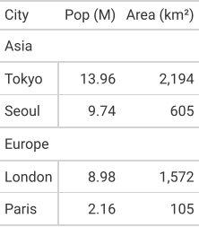

A table whose body is in two row groups, each with a label, and whose first column is the stub.

Each tab is the real output of `gridwell convert`, and the docs' tests check
that it still is. The Preview is the HTML writer's output as it renders on this page;
the HTML tab shows its markup without the base stylesheet (`"base_styles": false`),
which the Preview has. The ANSI tab is drawn without color (`"color": false`).


::: {.callout-note collapse="true" appearance="simple"}
## The IR: `fixtures/minimal/row_group_multiple.json`

<!-- gridwell file fixtures/minimal/row_group_multiple.json -->
```json
{
  "ir_version": "1.0",

  "config": {
    "table_cols": 3,
    "header_rows": 1,
    "body_rows": 4,
    "stub_cols": 1,
    "row_striping": false,
    "row_striping_include_stub": false,
    "row_striping_include_body": false,
    "column_labels_hidden": false,
    "table_width": null,
    "container_width": null,
    "container_height": null,
    "container_overflow": null,
    "locale": "en-US",
    "page_break_mode": "avoid",
    "aria_label": null,
    "aria_describedby": null,
    "summary": null
  },

  "styles": {
    "defs": {},
    "compositions": {},
    "conditionals": []
  },

  "header": {
    "title": null,
    "subtitle": null,
    "extra_lines": [],
    "preheader_content": null
  },

  "column_spec": [
    { "id": "col_0", "align": "left", "align_char": null, "width": "auto", "min_width": null, "max_width": null, "style_id": null, "hidden": false, "label": "City" },
    { "id": "col_1", "align": "right", "align_char": null, "width": "auto", "min_width": null, "max_width": null, "style_id": null, "hidden": false, "label": "Pop" },
    { "id": "col_2", "align": "right", "align_char": null, "width": "auto", "min_width": null, "max_width": null, "style_id": null, "hidden": false, "label": "Area" }
  ],

  "table": {
    "thead": {
      "rows": [
        {
          "role": "column_label",
          "style_id": null,
          "cells": [
            { "content": [{ "type": "text", "value": "City" }], "colspan": 1, "rowspan": 1, "style_id": null, "is_stub": true, "is_placeholder": false, "scope": "col" },
            { "content": [{ "type": "text", "value": "Pop (M)" }], "colspan": 1, "rowspan": 1, "style_id": null, "is_stub": false, "is_placeholder": false, "scope": "col" },
            { "content": [{ "type": "text", "value": "Area (km\u00b2)" }], "colspan": 1, "rowspan": 1, "style_id": null, "is_stub": false, "is_placeholder": false, "scope": "col" }
          ]
        }
      ]
    },

    "tbody": [
      {
        "group_id": "grp_asia",
        "label": {
          "content": [{ "type": "text", "value": "Asia" }],
          "style_id": null,
          "colspan": null
        },
        "rows": [
          {
            "role": null, "style_id": null,
            "cells": [
              { "content": [{ "type": "text", "value": "Tokyo" }], "typed_value": { "type": "string", "value": "Tokyo" }, "colspan": 1, "rowspan": 1, "style_id": null, "is_stub": true, "is_placeholder": false },
              { "content": [{ "type": "text", "value": "13.96" }], "typed_value": { "type": "number", "value": 13.96 }, "colspan": 1, "rowspan": 1, "style_id": null, "is_stub": false, "is_placeholder": false },
              { "content": [{ "type": "text", "value": "2,194" }], "typed_value": { "type": "number", "value": 2194 }, "colspan": 1, "rowspan": 1, "style_id": null, "is_stub": false, "is_placeholder": false }
            ]
          },
          {
            "role": null, "style_id": null,
            "cells": [
              { "content": [{ "type": "text", "value": "Seoul" }], "typed_value": { "type": "string", "value": "Seoul" }, "colspan": 1, "rowspan": 1, "style_id": null, "is_stub": true, "is_placeholder": false },
              { "content": [{ "type": "text", "value": "9.74" }], "typed_value": { "type": "number", "value": 9.74 }, "colspan": 1, "rowspan": 1, "style_id": null, "is_stub": false, "is_placeholder": false },
              { "content": [{ "type": "text", "value": "605" }], "typed_value": { "type": "number", "value": 605 }, "colspan": 1, "rowspan": 1, "style_id": null, "is_stub": false, "is_placeholder": false }
            ]
          }
        ],
        "summary_rows": []
      },
      {
        "group_id": "grp_europe",
        "label": {
          "content": [{ "type": "text", "value": "Europe" }],
          "style_id": null,
          "colspan": null
        },
        "rows": [
          {
            "role": null, "style_id": null,
            "cells": [
              { "content": [{ "type": "text", "value": "London" }], "typed_value": { "type": "string", "value": "London" }, "colspan": 1, "rowspan": 1, "style_id": null, "is_stub": true, "is_placeholder": false },
              { "content": [{ "type": "text", "value": "8.98" }], "typed_value": { "type": "number", "value": 8.98 }, "colspan": 1, "rowspan": 1, "style_id": null, "is_stub": false, "is_placeholder": false },
              { "content": [{ "type": "text", "value": "1,572" }], "typed_value": { "type": "number", "value": 1572 }, "colspan": 1, "rowspan": 1, "style_id": null, "is_stub": false, "is_placeholder": false }
            ]
          },
          {
            "role": null, "style_id": null,
            "cells": [
              { "content": [{ "type": "text", "value": "Paris" }], "typed_value": { "type": "string", "value": "Paris" }, "colspan": 1, "rowspan": 1, "style_id": null, "is_stub": true, "is_placeholder": false },
              { "content": [{ "type": "text", "value": "2.16" }], "typed_value": { "type": "number", "value": 2.16 }, "colspan": 1, "rowspan": 1, "style_id": null, "is_stub": false, "is_placeholder": false },
              { "content": [{ "type": "text", "value": "105" }], "typed_value": { "type": "number", "value": 105 }, "colspan": 1, "rowspan": 1, "style_id": null, "is_stub": false, "is_placeholder": false }
            ]
          }
        ],
        "summary_rows": []
      }
    ]
  },

  "footer": { "footnotes": [], "source_notes": [] },
  "extensions": {}
}
```
:::

::: {.panel-tabset}

### Preview

<!-- gridwell convert fixtures/minimal/row_group_multiple.json --to html --options '{"table_id": "grouped", "quarto_disable_processing": true}' -->
```{=html}
<div id="grouped" class="gw_container">
  <style>
    :where(#grouped.gw_container) { font-family: system-ui, 'Segoe UI', Roboto, Helvetica, Arial, sans-serif; color: #333333; font-size: 16px; line-height: normal; -webkit-font-smoothing: antialiased; -moz-osx-font-smoothing: grayscale; width: fit-content; max-width: 100%; margin-left: auto; margin-right: auto }
    :where(#grouped .gw_title:first-of-type, #grouped .gw_subtitle:first-of-type, #grouped .gw_header_line:first-of-type) { border-top: 2px solid #A8A8A8 }
    :where(#grouped .gw_title) { font-size: 125%; text-align: center; padding: 4px 5px }
    :where(#grouped .gw_subtitle) { font-size: 85%; text-align: center; padding: 3px 5px 5px }
    :where(#grouped .gw_header_line) { font-size: 85%; text-align: center; padding: 0 5px 5px }
    :where(#grouped .gw_table) { border-collapse: collapse; margin: 0; width: 100%; border-top: 2px solid #D3D3D3; border-bottom: 2px solid #D3D3D3 }
    :where(#grouped .gw_cells_top) { border-top: none }
    :where(#grouped .gw_cells_bottom) { border-bottom: none }
    :where(#grouped .gw_table td, #grouped .gw_table th) { padding: 8px 5px; border-top: 1px solid #D3D3D3 }
    :where(#grouped .gw_table > tbody:first-of-type > tr:first-child > *) { border-top: none }
    :where(#grouped .gw_table th) { font-weight: inherit }
    :where(#grouped .gw_table thead th) { border-top: none; padding: 5px 5px 6px }
    :where(#grouped .gw_table thead tr) { vertical-align: bottom }
    :where(#grouped .gw_table thead) { border-bottom: 2px solid #D3D3D3 }
    :where(#grouped .gw_table thead:last-child) { border-bottom: none }
    :where(#grouped .gw_cells_head thead) { border-bottom: none }
    :where(#grouped .gw_spanner) { padding: 5px 4px 7px; background-image: linear-gradient(#D3D3D3, #D3D3D3); background-size: calc(100% - 8px) 2px; background-position: bottom center; background-repeat: no-repeat }
    :where(#grouped .gw_spanner:first-child) { padding-left: 0; background-size: calc(100% - 4px) 2px; background-position: bottom left }
    :where(#grouped .gw_spanner:last-child) { padding-right: 0; background-size: calc(100% - 4px) 2px; background-position: bottom right }
    :where(#grouped .gw_spanner:first-child:last-child) { background-size: 100% 2px }
    :where(#grouped .gw_group_label) { border-top: 2px solid #D3D3D3; border-bottom: 2px solid #D3D3D3 }
    :where(#grouped .gw_stub) { border-right: 2px solid #D3D3D3 }
    :where(#grouped tbody > tr.gw_summary:first-child > *, #grouped tr:not(.gw_summary) + tr.gw_summary > *) { border-top: 2px solid #D3D3D3 }
    :where(#grouped tbody > tr.gw_grand_summary:first-child:not(.gw_summary_top) > *, #grouped tr:not(.gw_grand_summary) + tr.gw_grand_summary:not(.gw_summary_top) > *) { border-top: 6px double #D3D3D3 }
    :where(#grouped tr.gw_summary_end > *) { border-bottom: 2px solid #D3D3D3 }
    :where(#grouped tr.gw_grand_summary.gw_summary_end > *) { border-bottom: 6px double #D3D3D3 }
    :where(#grouped .gw_rule_top) { border-top: 2px solid #D3D3D3 }
    :where(#grouped thead .gw_rule_head) { border-bottom: 2px solid #D3D3D3 }
    :where(#grouped tbody .gw_rule_head) { border-top: 2px solid #D3D3D3 }
    :where(#grouped .gw_rule_bottom) { border-bottom: 2px solid #D3D3D3 }
    :where(#grouped .gw_table tbody .gw__al_right) { font-variant-numeric: tabular-nums }
    :where(#grouped .gw_footer) { border-bottom: 2px solid #A8A8A8 }
    :where(#grouped .gw_footnote, #grouped .gw_source_note) { margin: 0; font-size: 90%; padding: 4px 5px }
    :where(#grouped .gw_footnote_mark) { font-size: 75%; vertical-align: 0.4em; line-height: 0; font-style: italic }
    :where(#grouped .gw_footnote_mark a) { color: inherit; text-decoration: none }
    #grouped .gw_table .gw__al_left { text-align: left }
    #grouped .gw_table .gw__al_right { text-align: right }
  </style>
  <table class="gw_table" data-quarto-disable-processing="true">
    <thead>
      <tr class="gw_col_labels">
        <th class="gw_stubhead gw__al_left" scope="col" id="grouped-City">City</th>
        <th class="gw_col_label gw__al_right" scope="col" id="grouped-col_1">Pop (M)</th>
        <th class="gw_col_label gw__al_right" scope="col" id="grouped-col_2">Area (km²)</th>
      </tr>
    </thead>
    <tbody>
      <tr>
        <th colspan="3" scope="colgroup" class="gw_group_label gw__al_left" id="grouped-grp_asia">
          Asia
        </th>
      </tr>
      <tr>
        <th class="gw_stub gw__al_left" scope="row" id="grouped-stub-1">Tokyo</th>
        <td class="gw__al_right" headers="grouped-grp_asia grouped-stub-1 grouped-col_1">13.96</td>
        <td class="gw__al_right" headers="grouped-grp_asia grouped-stub-1 grouped-col_2">2,194</td>
      </tr>
      <tr>
        <th class="gw_stub gw__al_left" scope="row" id="grouped-stub-2">Seoul</th>
        <td class="gw__al_right" headers="grouped-grp_asia grouped-stub-2 grouped-col_1">9.74</td>
        <td class="gw__al_right" headers="grouped-grp_asia grouped-stub-2 grouped-col_2">605</td>
      </tr>
    </tbody>
    <tbody>
      <tr>
        <th colspan="3" scope="colgroup" class="gw_group_label gw__al_left" id="grouped-grp_europe">
          Europe
        </th>
      </tr>
      <tr>
        <th class="gw_stub gw__al_left" scope="row" id="grouped-stub-3">London</th>
        <td class="gw__al_right" headers="grouped-grp_europe grouped-stub-3 grouped-col_1">8.98</td>
        <td class="gw__al_right" headers="grouped-grp_europe grouped-stub-3 grouped-col_2">1,572</td>
      </tr>
      <tr>
        <th class="gw_stub gw__al_left" scope="row" id="grouped-stub-4">Paris</th>
        <td class="gw__al_right" headers="grouped-grp_europe grouped-stub-4 grouped-col_1">2.16</td>
        <td class="gw__al_right" headers="grouped-grp_europe grouped-stub-4 grouped-col_2">105</td>
      </tr>
    </tbody>
  </table>
</div>
```

### HTML

<!-- gridwell convert fixtures/minimal/row_group_multiple.json --to html --options '{"base_styles": false}' -->
```html
<div class="gw_container">
  <style>
    .gw_table .gw__al_left { text-align: left }
    .gw_table .gw__al_right { text-align: right }
  </style>
  <table class="gw_table">
    <thead>
      <tr class="gw_col_labels">
        <th class="gw_stubhead gw__al_left" scope="col" id="City">City</th>
        <th class="gw_col_label gw__al_right" scope="col" id="col_1">Pop (M)</th>
        <th class="gw_col_label gw__al_right" scope="col" id="col_2">Area (km²)</th>
      </tr>
    </thead>
    <tbody>
      <tr>
        <th colspan="3" scope="colgroup" class="gw_group_label gw__al_left" id="grp_asia">
          Asia
        </th>
      </tr>
      <tr>
        <th class="gw_stub gw__al_left" scope="row" id="stub-1">Tokyo</th>
        <td class="gw__al_right" headers="grp_asia stub-1 col_1">13.96</td>
        <td class="gw__al_right" headers="grp_asia stub-1 col_2">2,194</td>
      </tr>
      <tr>
        <th class="gw_stub gw__al_left" scope="row" id="stub-2">Seoul</th>
        <td class="gw__al_right" headers="grp_asia stub-2 col_1">9.74</td>
        <td class="gw__al_right" headers="grp_asia stub-2 col_2">605</td>
      </tr>
    </tbody>
    <tbody>
      <tr>
        <th colspan="3" scope="colgroup" class="gw_group_label gw__al_left" id="grp_europe">
          Europe
        </th>
      </tr>
      <tr>
        <th class="gw_stub gw__al_left" scope="row" id="stub-3">London</th>
        <td class="gw__al_right" headers="grp_europe stub-3 col_1">8.98</td>
        <td class="gw__al_right" headers="grp_europe stub-3 col_2">1,572</td>
      </tr>
      <tr>
        <th class="gw_stub gw__al_left" scope="row" id="stub-4">Paris</th>
        <td class="gw__al_right" headers="grp_europe stub-4 col_1">2.16</td>
        <td class="gw__al_right" headers="grp_europe stub-4 col_2">105</td>
      </tr>
    </tbody>
  </table>
</div>
```

### LaTeX

<!-- gridwell convert fixtures/minimal/row_group_multiple.json --to latex -->
```latex
\begin{tabular}{lrr}
\toprule
City & Pop (M) & Area (km²) \\
\midrule
\multicolumn{3}{l}{\bfseries Asia} \\
\midrule
Tokyo & 13.96 & 2,194 \\
Seoul & 9.74 & 605 \\
\midrule
\multicolumn{3}{l}{\bfseries Europe} \\
\midrule
London & 8.98 & 1,572 \\
Paris & 2.16 & 105 \\
\bottomrule
\end{tabular}
```

### Typst

<!-- gridwell convert fixtures/minimal/row_group_multiple.json --to typst -->
```typst
#table(
  columns: (auto, auto, auto,),
  align: (left, right, right,),
  stroke: none,
  table.header(
    [#text(weight: "bold")[City]],
    [#text(weight: "bold")[Pop \(M\)]],
    [#text(weight: "bold")[Area \(km²\)]],
    table.hline(stroke: 0.5pt),
  ),
  table.hline(stroke: 0.5pt),
  table.cell(colspan: 3, fill: luma(240))[#text(weight: "bold")[Asia]],
  table.hline(stroke: 0.5pt),
  [Tokyo],
  [13\.96],
  [2\,194],
  [Seoul],
  [9\.74],
  [605],
  table.hline(stroke: 0.3pt),
  table.hline(stroke: 0.5pt),
  table.cell(colspan: 3, fill: luma(240))[#text(weight: "bold")[Europe]],
  table.hline(stroke: 0.5pt),
  [London],
  [8\.98],
  [1\,572],
  [Paris],
  [2\.16],
  [105],
)
```

### SVG

<!-- gridwell convert fixtures/minimal/row_group_multiple.json -o docs/demos/images/grouped.svg -->
{fig-alt="The table as drawn by gridwell's SVG writer"}

### ANSI

<!-- gridwell convert fixtures/minimal/row_group_multiple.json --to ansi --options '{"color": false}' -->
```text
┌────────────┬────────────┬────────────┐
│ City       │    Pop (M) │ Area (km²) │
├────────────┴────────────┴────────────┤
│ Asia                                 │
├────────────┬────────────┬────────────┤
│ Tokyo      │      13.96 │      2,194 │
│ Seoul      │       9.74 │        605 │
├────────────┴────────────┴────────────┤
│ Europe                               │
├────────────┬────────────┬────────────┤
│ London     │       8.98 │      1,572 │
│ Paris      │       2.16 │        105 │
└────────────┴────────────┴────────────┘
```

:::
