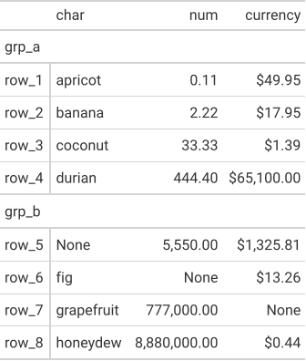

The whole pipeline: a table made with [Great Tables](https://posit-dev.github.io/great-tables/)
in Python, turned into gridwell IR, and rendered by gridwell's writers.

## Python code

```python
from great_tables import GT, exibble
import gridwell

gt = (
    GT(
        exibble[["row", "group", "char", "num", "currency"]],
        rowname_col="row",
        groupname_col="group",
        id="groups_and_stub",
    )
    .fmt_number(columns="num", decimals=2)
    .fmt_currency(columns="currency", currency="USD")
)

table = gridwell.Table(gt)    # the table as gridwell IR
assert table.validate() == []
print(table.render("latex"))
```

This is the `groups_and_stub` case of the [conformance kit](https://github.com/rich-iannone/gridwell/tree/main/conformance),
and the IR below is the one checked in for it, which the Python tests keep current.

::: {.callout-note collapse="true" appearance="simple"}
## The IR: `harness/gt-reference-py/groups_and_stub.ir.json`

<!-- gridwell file harness/gt-reference-py/groups_and_stub.ir.json -->
```json
{
  "ir_version": "1.0",
  "config": {
    "table_cols": 4,
    "header_rows": 1,
    "body_rows": 8,
    "stub_cols": 1,
    "row_striping": false,
    "row_striping_include_stub": false,
    "row_striping_include_body": false,
    "column_labels_hidden": false,
    "table_width": null,
    "container_width": null,
    "container_height": null,
    "container_overflow": null,
    "locale": "en-US",
    "page_break_mode": "avoid",
    "aria_label": null,
    "aria_describedby": null,
    "summary": null,
    "id": "groups_and_stub"
  },
  "styles": {
    "defs": {},
    "compositions": {},
    "conditionals": []
  },
  "header": {
    "title": null,
    "subtitle": null,
    "extra_lines": [],
    "preheader_content": null
  },
  "column_spec": [
    {
      "id": "row",
      "align": "left",
      "align_char": null,
      "width": "auto",
      "min_width": null,
      "max_width": null,
      "style_id": null,
      "hidden": false,
      "label": "row"
    },
    {
      "id": "char",
      "align": "left",
      "align_char": null,
      "width": "auto",
      "min_width": null,
      "max_width": null,
      "style_id": null,
      "hidden": false,
      "label": "char"
    },
    {
      "id": "num",
      "align": "right",
      "align_char": null,
      "width": "auto",
      "min_width": null,
      "max_width": null,
      "style_id": null,
      "hidden": false,
      "label": "num"
    },
    {
      "id": "currency",
      "align": "right",
      "align_char": null,
      "width": "auto",
      "min_width": null,
      "max_width": null,
      "style_id": null,
      "hidden": false,
      "label": "currency"
    }
  ],
  "table": {
    "thead": {
      "rows": [
        {
          "role": "column_label",
          "style_id": null,
          "cells": [
            {
              "content": [],
              "colspan": 1,
              "rowspan": 1,
              "style_id": null,
              "is_stub": false,
              "is_placeholder": false,
              "scope": "col"
            },
            {
              "content": [
                {
                  "type": "text",
                  "value": "char"
                }
              ],
              "colspan": 1,
              "rowspan": 1,
              "style_id": null,
              "is_stub": false,
              "is_placeholder": false,
              "scope": "col"
            },
            {
              "content": [
                {
                  "type": "text",
                  "value": "num"
                }
              ],
              "colspan": 1,
              "rowspan": 1,
              "style_id": null,
              "is_stub": false,
              "is_placeholder": false,
              "scope": "col"
            },
            {
              "content": [
                {
                  "type": "text",
                  "value": "currency"
                }
              ],
              "colspan": 1,
              "rowspan": 1,
              "style_id": null,
              "is_stub": false,
              "is_placeholder": false,
              "scope": "col"
            }
          ]
        }
      ]
    },
    "tbody": [
      {
        "group_id": "grp_a",
        "label": {
          "content": [
            {
              "type": "text",
              "value": "grp_a"
            }
          ],
          "style_id": null,
          "colspan": null
        },
        "rows": [
          {
            "role": null,
            "style_id": null,
            "cells": [
              {
                "content": [
                  {
                    "type": "text",
                    "value": "row_1"
                  }
                ],
                "colspan": 1,
                "rowspan": 1,
                "style_id": null,
                "is_stub": true,
                "is_placeholder": false,
                "scope": "row"
              },
              {
                "content": [
                  {
                    "type": "text",
                    "value": "apricot"
                  }
                ],
                "colspan": 1,
                "rowspan": 1,
                "style_id": null,
                "is_stub": false,
                "is_placeholder": false,
                "typed_value": {
                  "type": "string",
                  "value": "apricot"
                }
              },
              {
                "content": [
                  {
                    "type": "text",
                    "value": "0.11"
                  }
                ],
                "colspan": 1,
                "rowspan": 1,
                "style_id": null,
                "is_stub": false,
                "is_placeholder": false,
                "typed_value": {
                  "type": "number",
                  "value": 0.11
                }
              },
              {
                "content": [
                  {
                    "type": "text",
                    "value": "$49.95"
                  }
                ],
                "colspan": 1,
                "rowspan": 1,
                "style_id": null,
                "is_stub": false,
                "is_placeholder": false,
                "typed_value": {
                  "type": "number",
                  "value": 49.95
                }
              }
            ]
          },
          {
            "role": null,
            "style_id": null,
            "cells": [
              {
                "content": [
                  {
                    "type": "text",
                    "value": "row_2"
                  }
                ],
                "colspan": 1,
                "rowspan": 1,
                "style_id": null,
                "is_stub": true,
                "is_placeholder": false,
                "scope": "row"
              },
              {
                "content": [
                  {
                    "type": "text",
                    "value": "banana"
                  }
                ],
                "colspan": 1,
                "rowspan": 1,
                "style_id": null,
                "is_stub": false,
                "is_placeholder": false,
                "typed_value": {
                  "type": "string",
                  "value": "banana"
                }
              },
              {
                "content": [
                  {
                    "type": "text",
                    "value": "2.22"
                  }
                ],
                "colspan": 1,
                "rowspan": 1,
                "style_id": null,
                "is_stub": false,
                "is_placeholder": false,
                "typed_value": {
                  "type": "number",
                  "value": 2.22
                }
              },
              {
                "content": [
                  {
                    "type": "text",
                    "value": "$17.95"
                  }
                ],
                "colspan": 1,
                "rowspan": 1,
                "style_id": null,
                "is_stub": false,
                "is_placeholder": false,
                "typed_value": {
                  "type": "number",
                  "value": 17.95
                }
              }
            ]
          },
          {
            "role": null,
            "style_id": null,
            "cells": [
              {
                "content": [
                  {
                    "type": "text",
                    "value": "row_3"
                  }
                ],
                "colspan": 1,
                "rowspan": 1,
                "style_id": null,
                "is_stub": true,
                "is_placeholder": false,
                "scope": "row"
              },
              {
                "content": [
                  {
                    "type": "text",
                    "value": "coconut"
                  }
                ],
                "colspan": 1,
                "rowspan": 1,
                "style_id": null,
                "is_stub": false,
                "is_placeholder": false,
                "typed_value": {
                  "type": "string",
                  "value": "coconut"
                }
              },
              {
                "content": [
                  {
                    "type": "text",
                    "value": "33.33"
                  }
                ],
                "colspan": 1,
                "rowspan": 1,
                "style_id": null,
                "is_stub": false,
                "is_placeholder": false,
                "typed_value": {
                  "type": "number",
                  "value": 33.33
                }
              },
              {
                "content": [
                  {
                    "type": "text",
                    "value": "$1.39"
                  }
                ],
                "colspan": 1,
                "rowspan": 1,
                "style_id": null,
                "is_stub": false,
                "is_placeholder": false,
                "typed_value": {
                  "type": "number",
                  "value": 1.39
                }
              }
            ]
          },
          {
            "role": null,
            "style_id": null,
            "cells": [
              {
                "content": [
                  {
                    "type": "text",
                    "value": "row_4"
                  }
                ],
                "colspan": 1,
                "rowspan": 1,
                "style_id": null,
                "is_stub": true,
                "is_placeholder": false,
                "scope": "row"
              },
              {
                "content": [
                  {
                    "type": "text",
                    "value": "durian"
                  }
                ],
                "colspan": 1,
                "rowspan": 1,
                "style_id": null,
                "is_stub": false,
                "is_placeholder": false,
                "typed_value": {
                  "type": "string",
                  "value": "durian"
                }
              },
              {
                "content": [
                  {
                    "type": "text",
                    "value": "444.40"
                  }
                ],
                "colspan": 1,
                "rowspan": 1,
                "style_id": null,
                "is_stub": false,
                "is_placeholder": false,
                "typed_value": {
                  "type": "number",
                  "value": 444.4
                }
              },
              {
                "content": [
                  {
                    "type": "text",
                    "value": "$65,100.00"
                  }
                ],
                "colspan": 1,
                "rowspan": 1,
                "style_id": null,
                "is_stub": false,
                "is_placeholder": false,
                "typed_value": {
                  "type": "number",
                  "value": 65100.0
                }
              }
            ]
          }
        ],
        "summary_rows": []
      },
      {
        "group_id": "grp_b",
        "label": {
          "content": [
            {
              "type": "text",
              "value": "grp_b"
            }
          ],
          "style_id": null,
          "colspan": null
        },
        "rows": [
          {
            "role": null,
            "style_id": null,
            "cells": [
              {
                "content": [
                  {
                    "type": "text",
                    "value": "row_5"
                  }
                ],
                "colspan": 1,
                "rowspan": 1,
                "style_id": null,
                "is_stub": true,
                "is_placeholder": false,
                "scope": "row"
              },
              {
                "content": [
                  {
                    "type": "text",
                    "value": "None"
                  }
                ],
                "colspan": 1,
                "rowspan": 1,
                "style_id": null,
                "is_stub": false,
                "is_placeholder": false
              },
              {
                "content": [
                  {
                    "type": "text",
                    "value": "5,550.00"
                  }
                ],
                "colspan": 1,
                "rowspan": 1,
                "style_id": null,
                "is_stub": false,
                "is_placeholder": false,
                "typed_value": {
                  "type": "number",
                  "value": 5550.0
                }
              },
              {
                "content": [
                  {
                    "type": "text",
                    "value": "$1,325.81"
                  }
                ],
                "colspan": 1,
                "rowspan": 1,
                "style_id": null,
                "is_stub": false,
                "is_placeholder": false,
                "typed_value": {
                  "type": "number",
                  "value": 1325.81
                }
              }
            ]
          },
          {
            "role": null,
            "style_id": null,
            "cells": [
              {
                "content": [
                  {
                    "type": "text",
                    "value": "row_6"
                  }
                ],
                "colspan": 1,
                "rowspan": 1,
                "style_id": null,
                "is_stub": true,
                "is_placeholder": false,
                "scope": "row"
              },
              {
                "content": [
                  {
                    "type": "text",
                    "value": "fig"
                  }
                ],
                "colspan": 1,
                "rowspan": 1,
                "style_id": null,
                "is_stub": false,
                "is_placeholder": false,
                "typed_value": {
                  "type": "string",
                  "value": "fig"
                }
              },
              {
                "content": [
                  {
                    "type": "text",
                    "value": "None"
                  }
                ],
                "colspan": 1,
                "rowspan": 1,
                "style_id": null,
                "is_stub": false,
                "is_placeholder": false
              },
              {
                "content": [
                  {
                    "type": "text",
                    "value": "$13.26"
                  }
                ],
                "colspan": 1,
                "rowspan": 1,
                "style_id": null,
                "is_stub": false,
                "is_placeholder": false,
                "typed_value": {
                  "type": "number",
                  "value": 13.26
                }
              }
            ]
          },
          {
            "role": null,
            "style_id": null,
            "cells": [
              {
                "content": [
                  {
                    "type": "text",
                    "value": "row_7"
                  }
                ],
                "colspan": 1,
                "rowspan": 1,
                "style_id": null,
                "is_stub": true,
                "is_placeholder": false,
                "scope": "row"
              },
              {
                "content": [
                  {
                    "type": "text",
                    "value": "grapefruit"
                  }
                ],
                "colspan": 1,
                "rowspan": 1,
                "style_id": null,
                "is_stub": false,
                "is_placeholder": false,
                "typed_value": {
                  "type": "string",
                  "value": "grapefruit"
                }
              },
              {
                "content": [
                  {
                    "type": "text",
                    "value": "777,000.00"
                  }
                ],
                "colspan": 1,
                "rowspan": 1,
                "style_id": null,
                "is_stub": false,
                "is_placeholder": false,
                "typed_value": {
                  "type": "number",
                  "value": 777000.0
                }
              },
              {
                "content": [
                  {
                    "type": "text",
                    "value": "None"
                  }
                ],
                "colspan": 1,
                "rowspan": 1,
                "style_id": null,
                "is_stub": false,
                "is_placeholder": false
              }
            ]
          },
          {
            "role": null,
            "style_id": null,
            "cells": [
              {
                "content": [
                  {
                    "type": "text",
                    "value": "row_8"
                  }
                ],
                "colspan": 1,
                "rowspan": 1,
                "style_id": null,
                "is_stub": true,
                "is_placeholder": false,
                "scope": "row"
              },
              {
                "content": [
                  {
                    "type": "text",
                    "value": "honeydew"
                  }
                ],
                "colspan": 1,
                "rowspan": 1,
                "style_id": null,
                "is_stub": false,
                "is_placeholder": false,
                "typed_value": {
                  "type": "string",
                  "value": "honeydew"
                }
              },
              {
                "content": [
                  {
                    "type": "text",
                    "value": "8,880,000.00"
                  }
                ],
                "colspan": 1,
                "rowspan": 1,
                "style_id": null,
                "is_stub": false,
                "is_placeholder": false,
                "typed_value": {
                  "type": "number",
                  "value": 8880000.0
                }
              },
              {
                "content": [
                  {
                    "type": "text",
                    "value": "$0.44"
                  }
                ],
                "colspan": 1,
                "rowspan": 1,
                "style_id": null,
                "is_stub": false,
                "is_placeholder": false,
                "typed_value": {
                  "type": "number",
                  "value": 0.44
                }
              }
            ]
          }
        ],
        "summary_rows": []
      }
    ]
  },
  "footer": {
    "footnotes": [],
    "source_notes": []
  },
  "extensions": {}
}
```
:::

## Outputs

Every tab but "Great Tables" is the real output of `gridwell convert` for that IR,
which the docs' tests check. "Great Tables" is Great Tables' own HTML for the same
table (`as_raw_html()`), to compare with gridwell's Preview. The HTML tab shows the
markup without the base stylesheet (`"base_styles": false`); the ANSI tab is drawn
without color.

::: {.panel-tabset}

### Preview

<!-- gridwell convert harness/gt-reference-py/groups_and_stub.ir.json --to html --options '{"table_id": "gt_demo", "quarto_disable_processing": true}' -->
```{=html}
<div id="gt_demo" class="gw_container">
  <style>
    :where(#gt_demo.gw_container) { font-family: system-ui, 'Segoe UI', Roboto, Helvetica, Arial, sans-serif; color: #333333; font-size: 16px; line-height: normal; -webkit-font-smoothing: antialiased; -moz-osx-font-smoothing: grayscale; width: fit-content; max-width: 100%; margin-left: auto; margin-right: auto }
    :where(#gt_demo .gw_title:first-of-type, #gt_demo .gw_subtitle:first-of-type, #gt_demo .gw_header_line:first-of-type) { border-top: 2px solid #A8A8A8 }
    :where(#gt_demo .gw_title) { font-size: 125%; text-align: center; padding: 4px 5px }
    :where(#gt_demo .gw_subtitle) { font-size: 85%; text-align: center; padding: 3px 5px 5px }
    :where(#gt_demo .gw_header_line) { font-size: 85%; text-align: center; padding: 0 5px 5px }
    :where(#gt_demo .gw_table) { border-collapse: collapse; margin: 0; width: 100%; border-top: 2px solid #D3D3D3; border-bottom: 2px solid #D3D3D3 }
    :where(#gt_demo .gw_cells_top) { border-top: none }
    :where(#gt_demo .gw_cells_bottom) { border-bottom: none }
    :where(#gt_demo .gw_table td, #gt_demo .gw_table th) { padding: 8px 5px; border-top: 1px solid #D3D3D3 }
    :where(#gt_demo .gw_table > tbody:first-of-type > tr:first-child > *) { border-top: none }
    :where(#gt_demo .gw_table th) { font-weight: inherit }
    :where(#gt_demo .gw_table thead th) { border-top: none; padding: 5px 5px 6px }
    :where(#gt_demo .gw_table thead tr) { vertical-align: bottom }
    :where(#gt_demo .gw_table thead) { border-bottom: 2px solid #D3D3D3 }
    :where(#gt_demo .gw_table thead:last-child) { border-bottom: none }
    :where(#gt_demo .gw_cells_head thead) { border-bottom: none }
    :where(#gt_demo .gw_spanner) { padding: 5px 4px 7px; background-image: linear-gradient(#D3D3D3, #D3D3D3); background-size: calc(100% - 8px) 2px; background-position: bottom center; background-repeat: no-repeat }
    :where(#gt_demo .gw_spanner:first-child) { padding-left: 0; background-size: calc(100% - 4px) 2px; background-position: bottom left }
    :where(#gt_demo .gw_spanner:last-child) { padding-right: 0; background-size: calc(100% - 4px) 2px; background-position: bottom right }
    :where(#gt_demo .gw_spanner:first-child:last-child) { background-size: 100% 2px }
    :where(#gt_demo .gw_group_label) { border-top: 2px solid #D3D3D3; border-bottom: 2px solid #D3D3D3 }
    :where(#gt_demo .gw_stub) { border-right: 2px solid #D3D3D3 }
    :where(#gt_demo tbody > tr.gw_summary:first-child > *, #gt_demo tr:not(.gw_summary) + tr.gw_summary > *) { border-top: 2px solid #D3D3D3 }
    :where(#gt_demo tbody > tr.gw_grand_summary:first-child:not(.gw_summary_top) > *, #gt_demo tr:not(.gw_grand_summary) + tr.gw_grand_summary:not(.gw_summary_top) > *) { border-top: 6px double #D3D3D3 }
    :where(#gt_demo tr.gw_summary_end > *) { border-bottom: 2px solid #D3D3D3 }
    :where(#gt_demo tr.gw_grand_summary.gw_summary_end > *) { border-bottom: 6px double #D3D3D3 }
    :where(#gt_demo .gw_rule_top) { border-top: 2px solid #D3D3D3 }
    :where(#gt_demo thead .gw_rule_head) { border-bottom: 2px solid #D3D3D3 }
    :where(#gt_demo tbody .gw_rule_head) { border-top: 2px solid #D3D3D3 }
    :where(#gt_demo .gw_rule_bottom) { border-bottom: 2px solid #D3D3D3 }
    :where(#gt_demo .gw_table tbody .gw__al_right) { font-variant-numeric: tabular-nums }
    :where(#gt_demo .gw_footer) { border-bottom: 2px solid #A8A8A8 }
    :where(#gt_demo .gw_footnote, #gt_demo .gw_source_note) { margin: 0; font-size: 90%; padding: 4px 5px }
    :where(#gt_demo .gw_footnote_mark) { font-size: 75%; vertical-align: 0.4em; line-height: 0; font-style: italic }
    :where(#gt_demo .gw_footnote_mark a) { color: inherit; text-decoration: none }
    #gt_demo .gw_table .gw__al_left { text-align: left }
    #gt_demo .gw_table .gw__al_right { text-align: right }
  </style>
  <table class="gw_table" data-quarto-disable-processing="true">
    <thead>
      <tr class="gw_col_labels">
        <th class="gw_stubhead gw__al_left" scope="col"></th>
        <th class="gw_col_label gw__al_left" scope="col" id="gt_demo-char">char</th>
        <th class="gw_col_label gw__al_right" scope="col" id="gt_demo-num">num</th>
        <th class="gw_col_label gw__al_right" scope="col" id="gt_demo-currency">currency</th>
      </tr>
    </thead>
    <tbody>
      <tr>
        <th colspan="4" scope="colgroup" class="gw_group_label gw__al_left" id="gt_demo-grp_a">
          grp_a
        </th>
      </tr>
      <tr>
        <th class="gw_stub gw__al_left" scope="row" id="gt_demo-stub-1">row_1</th>
        <td headers="gt_demo-grp_a gt_demo-stub-1 gt_demo-char">apricot</td>
        <td class="gw__al_right" headers="gt_demo-grp_a gt_demo-stub-1 gt_demo-num">0.11</td>
        <td class="gw__al_right" headers="gt_demo-grp_a gt_demo-stub-1 gt_demo-currency">$49.95</td>
      </tr>
      <tr>
        <th class="gw_stub gw__al_left" scope="row" id="gt_demo-stub-2">row_2</th>
        <td headers="gt_demo-grp_a gt_demo-stub-2 gt_demo-char">banana</td>
        <td class="gw__al_right" headers="gt_demo-grp_a gt_demo-stub-2 gt_demo-num">2.22</td>
        <td class="gw__al_right" headers="gt_demo-grp_a gt_demo-stub-2 gt_demo-currency">$17.95</td>
      </tr>
      <tr>
        <th class="gw_stub gw__al_left" scope="row" id="gt_demo-stub-3">row_3</th>
        <td headers="gt_demo-grp_a gt_demo-stub-3 gt_demo-char">coconut</td>
        <td class="gw__al_right" headers="gt_demo-grp_a gt_demo-stub-3 gt_demo-num">33.33</td>
        <td class="gw__al_right" headers="gt_demo-grp_a gt_demo-stub-3 gt_demo-currency">$1.39</td>
      </tr>
      <tr>
        <th class="gw_stub gw__al_left" scope="row" id="gt_demo-stub-4">row_4</th>
        <td headers="gt_demo-grp_a gt_demo-stub-4 gt_demo-char">durian</td>
        <td class="gw__al_right" headers="gt_demo-grp_a gt_demo-stub-4 gt_demo-num">444.40</td>
        <td class="gw__al_right" headers="gt_demo-grp_a gt_demo-stub-4 gt_demo-currency">$65,100.00</td>
      </tr>
    </tbody>
    <tbody>
      <tr>
        <th colspan="4" scope="colgroup" class="gw_group_label gw__al_left" id="gt_demo-grp_b">
          grp_b
        </th>
      </tr>
      <tr>
        <th class="gw_stub gw__al_left" scope="row" id="gt_demo-stub-5">row_5</th>
        <td headers="gt_demo-grp_b gt_demo-stub-5 gt_demo-char">None</td>
        <td class="gw__al_right" headers="gt_demo-grp_b gt_demo-stub-5 gt_demo-num">5,550.00</td>
        <td class="gw__al_right" headers="gt_demo-grp_b gt_demo-stub-5 gt_demo-currency">$1,325.81</td>
      </tr>
      <tr>
        <th class="gw_stub gw__al_left" scope="row" id="gt_demo-stub-6">row_6</th>
        <td headers="gt_demo-grp_b gt_demo-stub-6 gt_demo-char">fig</td>
        <td class="gw__al_right" headers="gt_demo-grp_b gt_demo-stub-6 gt_demo-num">None</td>
        <td class="gw__al_right" headers="gt_demo-grp_b gt_demo-stub-6 gt_demo-currency">$13.26</td>
      </tr>
      <tr>
        <th class="gw_stub gw__al_left" scope="row" id="gt_demo-stub-7">row_7</th>
        <td headers="gt_demo-grp_b gt_demo-stub-7 gt_demo-char">grapefruit</td>
        <td class="gw__al_right" headers="gt_demo-grp_b gt_demo-stub-7 gt_demo-num">777,000.00</td>
        <td class="gw__al_right" headers="gt_demo-grp_b gt_demo-stub-7 gt_demo-currency">None</td>
      </tr>
      <tr>
        <th class="gw_stub gw__al_left" scope="row" id="gt_demo-stub-8">row_8</th>
        <td headers="gt_demo-grp_b gt_demo-stub-8 gt_demo-char">honeydew</td>
        <td class="gw__al_right" headers="gt_demo-grp_b gt_demo-stub-8 gt_demo-num">8,880,000.00</td>
        <td class="gw__al_right" headers="gt_demo-grp_b gt_demo-stub-8 gt_demo-currency">$0.44</td>
      </tr>
    </tbody>
  </table>
</div>
```

### Great Tables

<!-- gridwell file harness/gt-reference-py/groups_and_stub.gt.html -->
```{=html}
<div id="groups_and_stub" style="padding-left:0px;padding-right:0px;padding-top:10px;padding-bottom:10px;overflow-x:auto;overflow-y:auto;width:auto;height:auto;">
<style>
#groups_and_stub table {
          font-family: -apple-system, BlinkMacSystemFont, 'Segoe UI', Roboto, Oxygen, Ubuntu, Cantarell, 'Helvetica Neue', 'Fira Sans', 'Droid Sans', Arial, sans-serif;
          -webkit-font-smoothing: antialiased;
          -moz-osx-font-smoothing: grayscale;
        }

#groups_and_stub thead, tbody, tfoot, tr, td, th { border-style: none; }
 tr { background-color: transparent; }
#groups_and_stub p { margin: 0; padding: 0; }
 #groups_and_stub .gt_table { display: table; border-collapse: collapse; line-height: normal; margin-left: auto; margin-right: auto; color: #333333; font-size: 16px; font-weight: normal; font-style: normal; background-color: #FFFFFF; width: auto; border-top-style: solid; border-top-width: 2px; border-top-color: #A8A8A8; border-right-style: none; border-right-width: 2px; border-right-color: #D3D3D3; border-bottom-style: solid; border-bottom-width: 2px; border-bottom-color: #A8A8A8; border-left-style: none; border-left-width: 2px; border-left-color: #D3D3D3; }
 #groups_and_stub .gt_caption { padding-top: 4px; padding-bottom: 4px; }
 #groups_and_stub .gt_title { color: #333333; font-size: 125%; font-weight: initial; padding-top: 4px; padding-bottom: 4px; padding-left: 5px; padding-right: 5px; border-bottom-color: #FFFFFF; border-bottom-width: 0; }
 #groups_and_stub .gt_subtitle { color: #333333; font-size: 85%; font-weight: initial; padding-top: 3px; padding-bottom: 5px; padding-left: 5px; padding-right: 5px; border-top-color: #FFFFFF; border-top-width: 0; }
 #groups_and_stub .gt_heading { background-color: #FFFFFF; text-align: center; border-bottom-color: #FFFFFF; border-left-style: none; border-left-width: 1px; border-left-color: #D3D3D3; border-right-style: none; border-right-width: 1px; border-right-color: #D3D3D3; }
 #groups_and_stub .gt_bottom_border { border-bottom-style: solid; border-bottom-width: 2px; border-bottom-color: #D3D3D3; }
 #groups_and_stub .gt_col_headings { border-top-style: solid; border-top-width: 2px; border-top-color: #D3D3D3; border-bottom-style: solid; border-bottom-width: 2px; border-bottom-color: #D3D3D3; border-left-style: none; border-left-width: 1px; border-left-color: #D3D3D3; border-right-style: none; border-right-width: 1px; border-right-color: #D3D3D3; }
 #groups_and_stub .gt_col_heading { color: #333333; background-color: #FFFFFF; font-size: 100%; font-weight: normal; text-transform: inherit; border-left-style: none; border-left-width: 1px; border-left-color: #D3D3D3; border-right-style: none; border-right-width: 1px; border-right-color: #D3D3D3; vertical-align: bottom; padding-top: 5px; padding-bottom: 5px; padding-left: 5px; padding-right: 5px; overflow-x: hidden; }
 #groups_and_stub .gt_column_spanner_outer { color: #333333; background-color: #FFFFFF; font-size: 100%; font-weight: normal; text-transform: inherit; padding-top: 0; padding-bottom: 0; padding-left: 4px; padding-right: 4px; }
 #groups_and_stub .gt_column_spanner_outer:first-child { padding-left: 0; }
 #groups_and_stub .gt_column_spanner_outer:last-child { padding-right: 0; }
 #groups_and_stub .gt_column_spanner { border-bottom-style: solid; border-bottom-width: 2px; border-bottom-color: #D3D3D3; vertical-align: bottom; padding-top: 5px; padding-bottom: 5px; overflow-x: hidden; display: inline-block; width: 100%; }
 #groups_and_stub .gt_spanner_row { border-bottom-style: hidden; }
 #groups_and_stub .gt_group_heading { padding-top: 8px; padding-bottom: 8px; padding-left: 5px; padding-right: 5px; color: #333333; background-color: #FFFFFF; font-size: 100%; font-weight: initial; text-transform: inherit; border-top-style: solid; border-top-width: 2px; border-top-color: #D3D3D3; border-bottom-style: solid; border-bottom-width: 2px; border-bottom-color: #D3D3D3; border-left-style: none; border-left-width: 1px; border-left-color: #D3D3D3; border-right-style: none; border-right-width: 1px; border-right-color: #D3D3D3; vertical-align: middle; text-align: left; }
 #groups_and_stub .gt_empty_group_heading { padding: 0.5px; color: #333333; background-color: #FFFFFF; font-size: 100%; font-weight: initial; border-top-style: solid; border-top-width: 2px; border-top-color: #D3D3D3; border-bottom-style: solid; border-bottom-width: 2px; border-bottom-color: #D3D3D3; vertical-align: middle; }
 #groups_and_stub .gt_from_md> :first-child { margin-top: 0; }
 #groups_and_stub .gt_from_md> :last-child { margin-bottom: 0; }
 #groups_and_stub .gt_row { padding-top: 8px; padding-bottom: 8px; padding-left: 5px; padding-right: 5px; margin: 10px; border-top-style: solid; border-top-width: 1px; border-top-color: #D3D3D3; border-left-style: none; border-left-width: 1px; border-left-color: #D3D3D3; border-right-style: none; border-right-width: 1px; border-right-color: #D3D3D3; vertical-align: middle; overflow-x: hidden; }
 #groups_and_stub .gt_stub { color: #333333; background-color: #FFFFFF; font-size: 100%; font-weight: initial; text-transform: inherit; border-right-style: solid; border-right-width: 2px; border-right-color: #D3D3D3; padding-left: 5px; padding-right: 5px; }
 #groups_and_stub .gt_indent_1 { text-indent: 5px; }
 #groups_and_stub .gt_indent_2 { text-indent: calc(5px * 2); }
 #groups_and_stub .gt_indent_3 { text-indent: calc(5px * 3); }
 #groups_and_stub .gt_indent_4 { text-indent: calc(5px * 4); }
 #groups_and_stub .gt_indent_5 { text-indent: calc(5px * 5); }
 #groups_and_stub .gt_stub_row_group { color: #333333; background-color: #FFFFFF; font-size: 100%; font-weight: initial; text-transform: inherit; border-right-style: solid; border-right-width: 2px; border-right-color: #D3D3D3; padding-left: 5px; padding-right: 5px; vertical-align: top; }
 #groups_and_stub .gt_row_group_first td { border-top-width: 2px; }
 #groups_and_stub .gt_row_group_first th { border-top-width: 2px; }
 #groups_and_stub .gt_striped { color: #333333; background-color: #F4F4F4; }
 #groups_and_stub .gt_table_body { border-top-style: solid; border-top-width: 2px; border-top-color: #D3D3D3; border-bottom-style: solid; border-bottom-width: 2px; border-bottom-color: #D3D3D3; }
 #groups_and_stub .gt_summary_row { color: #333333; background-color: #FFFFFF; text-transform: inherit; padding-top: 8px; padding-bottom: 8px; padding-left: 5px; padding-right: 5px; }
 #groups_and_stub .gt_first_summary_row { border-top-style: solid; border-top-width: 2px; border-top-color: #D3D3D3; }
 #groups_and_stub .gt_last_summary_row_top { border-bottom-style: solid; border-bottom-width: 2px; border-bottom-color: #D3D3D3; }
 #groups_and_stub .gt_grand_summary_row { color: #333333; background-color: #FFFFFF; text-transform: inherit; padding-top: 8px; padding-bottom: 8px; padding-left: 5px; padding-right: 5px; }
 #groups_and_stub .gt_first_grand_summary_row_bottom { border-top-style: double; border-top-width: 6px; border-top-color: #D3D3D3; }
 #groups_and_stub .gt_last_grand_summary_row_top { border-bottom-style: double; border-bottom-width: 6px; border-bottom-color: #D3D3D3; }
 #groups_and_stub .gt_sourcenotes { color: #333333; background-color: #FFFFFF; border-bottom-style: none; border-bottom-width: 2px; border-bottom-color: #D3D3D3; border-left-style: none; border-left-width: 2px; border-left-color: #D3D3D3; border-right-style: none; border-right-width: 2px; border-right-color: #D3D3D3; }
 #groups_and_stub .gt_sourcenote { font-size: 90%; padding-top: 4px; padding-bottom: 4px; padding-left: 5px; padding-right: 5px; text-align: left; }
 #groups_and_stub .gt_left { text-align: left; }
 #groups_and_stub .gt_center { text-align: center; }
 #groups_and_stub .gt_right { text-align: right; font-variant-numeric: tabular-nums; }
 #groups_and_stub .gt_font_normal { font-weight: normal; }
 #groups_and_stub .gt_font_bold { font-weight: bold; }
 #groups_and_stub .gt_font_italic { font-style: italic; }
 #groups_and_stub .gt_super { font-size: 65%; }
 #groups_and_stub .gt_footnotes { color: font-color(#FFFFFF); background-color: #FFFFFF; border-bottom-style: none; border-bottom-width: 2px; border-bottom-color: #D3D3D3; border-left-style: none; border-left-width: 2px; border-left-color: #D3D3D3; border-right-style: none; border-right-width: 2px; border-right-color: #D3D3D3; }
 #groups_and_stub .gt_footnote { margin: 0px; font-size: 90%; padding-top: 4px; padding-bottom: 4px; padding-left: 5px; padding-right: 5px; }
 #groups_and_stub .gt_sourcenotes { color: #333333; background-color: #FFFFFF; border-bottom-style: none; border-bottom-width: 2px; border-bottom-color: #D3D3D3; border-left-style: none; border-left-width: 2px; border-left-color: #D3D3D3; border-right-style: none; border-right-width: 2px; border-right-color: #D3D3D3; }
 #groups_and_stub .gt_sourcenote { font-size: 90%; padding-top: 4px; padding-bottom: 4px; padding-left: 5px; padding-right: 5px; text-align: left; }
 #groups_and_stub .gt_footnote_marks { font-size: 75%; vertical-align: 0.4em; position: initial; }
 #groups_and_stub .gt_asterisk { font-size: 100%; vertical-align: 0; }
 
</style>
<table class="gt_table" data-quarto-disable-processing="false" data-quarto-bootstrap="false">
<thead>

<tr class="gt_col_headings">
  <th class="gt_col_heading gt_columns_bottom_border gt_left" rowspan="1" colspan="1" scope="col"></th>
  <th class="gt_col_heading gt_columns_bottom_border gt_left" rowspan="1" colspan="1" scope="col" id="groups_and_stub-char">char</th>
  <th class="gt_col_heading gt_columns_bottom_border gt_right" rowspan="1" colspan="1" scope="col" id="groups_and_stub-num">num</th>
  <th class="gt_col_heading gt_columns_bottom_border gt_right" rowspan="1" colspan="1" scope="col" id="groups_and_stub-currency">currency</th>
</tr>
</thead>
<tbody class="gt_table_body">
  <tr class="gt_group_heading_row">
    <th class="gt_group_heading" colspan="4" scope="colgroup" id="groups_and_stub-grp_a">grp_a</th>
  </tr>
  <tr>
    <th scope="row" id="groups_and_stub-stub-1" class="gt_row gt_left gt_stub">row_1</th>
    <td headers="groups_and_stub-grp_a groups_and_stub-stub-1 groups_and_stub-char" class="gt_row gt_left">apricot</td>
    <td headers="groups_and_stub-grp_a groups_and_stub-stub-1 groups_and_stub-num" class="gt_row gt_right">0.11</td>
    <td headers="groups_and_stub-grp_a groups_and_stub-stub-1 groups_and_stub-currency" class="gt_row gt_right">$49.95</td>
  </tr>
  <tr>
    <th scope="row" id="groups_and_stub-stub-2" class="gt_row gt_left gt_stub">row_2</th>
    <td headers="groups_and_stub-grp_a groups_and_stub-stub-2 groups_and_stub-char" class="gt_row gt_left">banana</td>
    <td headers="groups_and_stub-grp_a groups_and_stub-stub-2 groups_and_stub-num" class="gt_row gt_right">2.22</td>
    <td headers="groups_and_stub-grp_a groups_and_stub-stub-2 groups_and_stub-currency" class="gt_row gt_right">$17.95</td>
  </tr>
  <tr>
    <th scope="row" id="groups_and_stub-stub-3" class="gt_row gt_left gt_stub">row_3</th>
    <td headers="groups_and_stub-grp_a groups_and_stub-stub-3 groups_and_stub-char" class="gt_row gt_left">coconut</td>
    <td headers="groups_and_stub-grp_a groups_and_stub-stub-3 groups_and_stub-num" class="gt_row gt_right">33.33</td>
    <td headers="groups_and_stub-grp_a groups_and_stub-stub-3 groups_and_stub-currency" class="gt_row gt_right">$1.39</td>
  </tr>
  <tr>
    <th scope="row" id="groups_and_stub-stub-4" class="gt_row gt_left gt_stub">row_4</th>
    <td headers="groups_and_stub-grp_a groups_and_stub-stub-4 groups_and_stub-char" class="gt_row gt_left">durian</td>
    <td headers="groups_and_stub-grp_a groups_and_stub-stub-4 groups_and_stub-num" class="gt_row gt_right">444.40</td>
    <td headers="groups_and_stub-grp_a groups_and_stub-stub-4 groups_and_stub-currency" class="gt_row gt_right">$65,100.00</td>
  </tr>
  <tr class="gt_group_heading_row">
    <th class="gt_group_heading" colspan="4" scope="colgroup" id="groups_and_stub-grp_b">grp_b</th>
  </tr>
  <tr>
    <th scope="row" id="groups_and_stub-stub-5" class="gt_row gt_left gt_stub">row_5</th>
    <td headers="groups_and_stub-grp_b groups_and_stub-stub-5 groups_and_stub-char" class="gt_row gt_left">None</td>
    <td headers="groups_and_stub-grp_b groups_and_stub-stub-5 groups_and_stub-num" class="gt_row gt_right">5,550.00</td>
    <td headers="groups_and_stub-grp_b groups_and_stub-stub-5 groups_and_stub-currency" class="gt_row gt_right">$1,325.81</td>
  </tr>
  <tr>
    <th scope="row" id="groups_and_stub-stub-6" class="gt_row gt_left gt_stub">row_6</th>
    <td headers="groups_and_stub-grp_b groups_and_stub-stub-6 groups_and_stub-char" class="gt_row gt_left">fig</td>
    <td headers="groups_and_stub-grp_b groups_and_stub-stub-6 groups_and_stub-num" class="gt_row gt_right">None</td>
    <td headers="groups_and_stub-grp_b groups_and_stub-stub-6 groups_and_stub-currency" class="gt_row gt_right">$13.26</td>
  </tr>
  <tr>
    <th scope="row" id="groups_and_stub-stub-7" class="gt_row gt_left gt_stub">row_7</th>
    <td headers="groups_and_stub-grp_b groups_and_stub-stub-7 groups_and_stub-char" class="gt_row gt_left">grapefruit</td>
    <td headers="groups_and_stub-grp_b groups_and_stub-stub-7 groups_and_stub-num" class="gt_row gt_right">777,000.00</td>
    <td headers="groups_and_stub-grp_b groups_and_stub-stub-7 groups_and_stub-currency" class="gt_row gt_right">None</td>
  </tr>
  <tr>
    <th scope="row" id="groups_and_stub-stub-8" class="gt_row gt_left gt_stub">row_8</th>
    <td headers="groups_and_stub-grp_b groups_and_stub-stub-8 groups_and_stub-char" class="gt_row gt_left">honeydew</td>
    <td headers="groups_and_stub-grp_b groups_and_stub-stub-8 groups_and_stub-num" class="gt_row gt_right">8,880,000.00</td>
    <td headers="groups_and_stub-grp_b groups_and_stub-stub-8 groups_and_stub-currency" class="gt_row gt_right">$0.44</td>
  </tr>
</tbody>

</table>

</div>
```

### HTML

<!-- gridwell convert harness/gt-reference-py/groups_and_stub.ir.json --to html --options '{"base_styles": false}' -->
```html
<div id="groups_and_stub" class="gw_container">
  <style>
    #groups_and_stub .gw_table .gw__al_left { text-align: left }
    #groups_and_stub .gw_table .gw__al_right { text-align: right }
  </style>
  <table class="gw_table">
    <thead>
      <tr class="gw_col_labels">
        <th class="gw_stubhead gw__al_left" scope="col"></th>
        <th class="gw_col_label gw__al_left" scope="col" id="groups_and_stub-char">char</th>
        <th class="gw_col_label gw__al_right" scope="col" id="groups_and_stub-num">num</th>
        <th class="gw_col_label gw__al_right" scope="col" id="groups_and_stub-currency">currency</th>
      </tr>
    </thead>
    <tbody>
      <tr>
        <th colspan="4" scope="colgroup" class="gw_group_label gw__al_left" id="groups_and_stub-grp_a">
          grp_a
        </th>
      </tr>
      <tr>
        <th class="gw_stub gw__al_left" scope="row" id="groups_and_stub-stub-1">row_1</th>
        <td headers="groups_and_stub-grp_a groups_and_stub-stub-1 groups_and_stub-char">apricot</td>
        <td class="gw__al_right" headers="groups_and_stub-grp_a groups_and_stub-stub-1 groups_and_stub-num">0.11</td>
        <td class="gw__al_right" headers="groups_and_stub-grp_a groups_and_stub-stub-1 groups_and_stub-currency">$49.95</td>
      </tr>
      <tr>
        <th class="gw_stub gw__al_left" scope="row" id="groups_and_stub-stub-2">row_2</th>
        <td headers="groups_and_stub-grp_a groups_and_stub-stub-2 groups_and_stub-char">banana</td>
        <td class="gw__al_right" headers="groups_and_stub-grp_a groups_and_stub-stub-2 groups_and_stub-num">2.22</td>
        <td class="gw__al_right" headers="groups_and_stub-grp_a groups_and_stub-stub-2 groups_and_stub-currency">$17.95</td>
      </tr>
      <tr>
        <th class="gw_stub gw__al_left" scope="row" id="groups_and_stub-stub-3">row_3</th>
        <td headers="groups_and_stub-grp_a groups_and_stub-stub-3 groups_and_stub-char">coconut</td>
        <td class="gw__al_right" headers="groups_and_stub-grp_a groups_and_stub-stub-3 groups_and_stub-num">33.33</td>
        <td class="gw__al_right" headers="groups_and_stub-grp_a groups_and_stub-stub-3 groups_and_stub-currency">$1.39</td>
      </tr>
      <tr>
        <th class="gw_stub gw__al_left" scope="row" id="groups_and_stub-stub-4">row_4</th>
        <td headers="groups_and_stub-grp_a groups_and_stub-stub-4 groups_and_stub-char">durian</td>
        <td class="gw__al_right" headers="groups_and_stub-grp_a groups_and_stub-stub-4 groups_and_stub-num">444.40</td>
        <td class="gw__al_right" headers="groups_and_stub-grp_a groups_and_stub-stub-4 groups_and_stub-currency">$65,100.00</td>
      </tr>
    </tbody>
    <tbody>
      <tr>
        <th colspan="4" scope="colgroup" class="gw_group_label gw__al_left" id="groups_and_stub-grp_b">
          grp_b
        </th>
      </tr>
      <tr>
        <th class="gw_stub gw__al_left" scope="row" id="groups_and_stub-stub-5">row_5</th>
        <td headers="groups_and_stub-grp_b groups_and_stub-stub-5 groups_and_stub-char">None</td>
        <td class="gw__al_right" headers="groups_and_stub-grp_b groups_and_stub-stub-5 groups_and_stub-num">5,550.00</td>
        <td class="gw__al_right" headers="groups_and_stub-grp_b groups_and_stub-stub-5 groups_and_stub-currency">$1,325.81</td>
      </tr>
      <tr>
        <th class="gw_stub gw__al_left" scope="row" id="groups_and_stub-stub-6">row_6</th>
        <td headers="groups_and_stub-grp_b groups_and_stub-stub-6 groups_and_stub-char">fig</td>
        <td class="gw__al_right" headers="groups_and_stub-grp_b groups_and_stub-stub-6 groups_and_stub-num">None</td>
        <td class="gw__al_right" headers="groups_and_stub-grp_b groups_and_stub-stub-6 groups_and_stub-currency">$13.26</td>
      </tr>
      <tr>
        <th class="gw_stub gw__al_left" scope="row" id="groups_and_stub-stub-7">row_7</th>
        <td headers="groups_and_stub-grp_b groups_and_stub-stub-7 groups_and_stub-char">grapefruit</td>
        <td class="gw__al_right" headers="groups_and_stub-grp_b groups_and_stub-stub-7 groups_and_stub-num">777,000.00</td>
        <td class="gw__al_right" headers="groups_and_stub-grp_b groups_and_stub-stub-7 groups_and_stub-currency">None</td>
      </tr>
      <tr>
        <th class="gw_stub gw__al_left" scope="row" id="groups_and_stub-stub-8">row_8</th>
        <td headers="groups_and_stub-grp_b groups_and_stub-stub-8 groups_and_stub-char">honeydew</td>
        <td class="gw__al_right" headers="groups_and_stub-grp_b groups_and_stub-stub-8 groups_and_stub-num">8,880,000.00</td>
        <td class="gw__al_right" headers="groups_and_stub-grp_b groups_and_stub-stub-8 groups_and_stub-currency">$0.44</td>
      </tr>
    </tbody>
  </table>
</div>
```

### LaTeX

<!-- gridwell convert harness/gt-reference-py/groups_and_stub.ir.json --to latex -->
```latex
\begin{tabular}{llrr}
\toprule
 & char & num & currency \\
\midrule
\multicolumn{4}{l}{\bfseries grp\_a} \\
\midrule
row\_1 & apricot & 0.11 & \$49.95 \\
row\_2 & banana & 2.22 & \$17.95 \\
row\_3 & coconut & 33.33 & \$1.39 \\
row\_4 & durian & 444.40 & \$65,100.00 \\
\midrule
\multicolumn{4}{l}{\bfseries grp\_b} \\
\midrule
row\_5 & None & 5,550.00 & \$1,325.81 \\
row\_6 & fig & None & \$13.26 \\
row\_7 & grapefruit & 777,000.00 & None \\
row\_8 & honeydew & 8,880,000.00 & \$0.44 \\
\bottomrule
\end{tabular}
```

### Typst

<!-- gridwell convert harness/gt-reference-py/groups_and_stub.ir.json --to typst -->
```typst
#table(
  columns: (auto, auto, auto, auto,),
  align: (left, left, right, right,),
  stroke: none,
  table.header(
    [],
    [#text(weight: "bold")[char]],
    [#text(weight: "bold")[num]],
    [#text(weight: "bold")[currency]],
    table.hline(stroke: 0.5pt),
  ),
  table.hline(stroke: 0.5pt),
  table.cell(colspan: 4, fill: luma(240))[#text(weight: "bold")[grp\_a]],
  table.hline(stroke: 0.5pt),
  [row\_1],
  [apricot],
  [0\.11],
  [\$49\.95],
  [row\_2],
  [banana],
  [2\.22],
  [\$17\.95],
  [row\_3],
  [coconut],
  [33\.33],
  [\$1\.39],
  [row\_4],
  [durian],
  [444\.40],
  [\$65\,100\.00],
  table.hline(stroke: 0.3pt),
  table.hline(stroke: 0.5pt),
  table.cell(colspan: 4, fill: luma(240))[#text(weight: "bold")[grp\_b]],
  table.hline(stroke: 0.5pt),
  [row\_5],
  [None],
  [5\,550\.00],
  [\$1\,325\.81],
  [row\_6],
  [fig],
  [None],
  [\$13\.26],
  [row\_7],
  [grapefruit],
  [777\,000\.00],
  [None],
  [row\_8],
  [honeydew],
  [8\,880\,000\.00],
  [\$0\.44],
)
```

### SVG

<!-- gridwell convert harness/gt-reference-py/groups_and_stub.ir.json -o docs/demos/images/gt_demo.svg -->
{fig-alt="The table as drawn by gridwell's SVG writer"}

### ANSI

<!-- gridwell convert harness/gt-reference-py/groups_and_stub.ir.json --to ansi --options '{"color": false}' -->
```text
┌────────────┬────────────┬──────────────┬────────────┐
│            │ char       │          num │   currency │
├────────────┴────────────┴──────────────┴────────────┤
│ grp_a                                               │
├────────────┬────────────┬──────────────┬────────────┤
│ row_1      │ apricot    │         0.11 │     $49.95 │
│ row_2      │ banana     │         2.22 │     $17.95 │
│ row_3      │ coconut    │        33.33 │      $1.39 │
│ row_4      │ durian     │       444.40 │ $65,100.00 │
├────────────┴────────────┴──────────────┴────────────┤
│ grp_b                                               │
├────────────┬────────────┬──────────────┬────────────┤
│ row_5      │ None       │     5,550.00 │  $1,325.81 │
│ row_6      │ fig        │         None │     $13.26 │
│ row_7      │ grapefruit │   777,000.00 │       None │
│ row_8      │ honeydew   │ 8,880,000.00 │      $0.44 │
└────────────┴────────────┴──────────────┴────────────┘
```

:::
