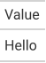

The simplest table: one column, one row.

Each tab is the real output of `gridwell convert`, and the docs' tests check
that it still is. The Preview is the HTML writer's output as it renders on this page;
the HTML tab shows its markup without the base stylesheet (`"base_styles": false`),
which the Preview has. The ANSI tab is drawn without color (`"color": false`).


::: {.callout-note collapse="true" appearance="simple"}
## The IR: `fixtures/minimal/minimal_1x1.json`

<!-- gridwell file fixtures/minimal/minimal_1x1.json -->
```json
{
  "ir_version": "1.0",

  "config": {
    "table_cols": 1,
    "header_rows": 1,
    "body_rows": 1,
    "stub_cols": 0,
    "row_striping": false,
    "row_striping_include_stub": false,
    "row_striping_include_body": false,
    "column_labels_hidden": false,
    "table_width": null,
    "container_width": null,
    "container_height": null,
    "container_overflow": null,
    "locale": "en-US",
    "page_break_mode": "avoid",
    "aria_label": null,
    "aria_describedby": null,
    "summary": null
  },

  "styles": {
    "defs": {},
    "compositions": {},
    "conditionals": []
  },

  "header": {
    "title": null,
    "subtitle": null,
    "extra_lines": [],
    "preheader_content": null
  },

  "column_spec": [
    {
      "id": "col_0",
      "align": "left",
      "align_char": null,
      "width": "auto",
      "min_width": null,
      "max_width": null,
      "style_id": null,
      "hidden": false,
      "label": "Value"
    }
  ],

  "table": {
    "thead": {
      "rows": [
        {
          "role": "column_label",
          "style_id": null,
          "cells": [
            {
              "content": [{ "type": "text", "value": "Value" }],
              "colspan": 1,
              "rowspan": 1,
              "style_id": null,
              "is_stub": false,
              "is_placeholder": false,
              "scope": "col"
            }
          ]
        }
      ]
    },

    "tbody": [
      {
        "group_id": null,
        "label": null,
        "rows": [
          {
            "role": null,
            "style_id": null,
            "cells": [
              {
                "content": [{ "type": "text", "value": "Hello" }],
                "typed_value": { "type": "string", "value": "Hello" },
                "colspan": 1,
                "rowspan": 1,
                "style_id": null,
                "is_stub": false,
                "is_placeholder": false
              }
            ]
          }
        ],
        "summary_rows": []
      }
    ]
  },

  "footer": {
    "footnotes": [],
    "source_notes": []
  },

  "extensions": {}
}
```
:::

::: {.panel-tabset}

### Preview

<!-- gridwell convert fixtures/minimal/minimal_1x1.json --to html --options '{"table_id": "minimal", "quarto_disable_processing": true}' -->
```{=html}
<div id="minimal" class="gw_container">
  <style>
    :where(#minimal.gw_container) { font-family: system-ui, 'Segoe UI', Roboto, Helvetica, Arial, sans-serif; color: #333333; font-size: 16px; line-height: normal; -webkit-font-smoothing: antialiased; -moz-osx-font-smoothing: grayscale; width: fit-content; max-width: 100%; margin-left: auto; margin-right: auto }
    :where(#minimal .gw_title:first-of-type, #minimal .gw_subtitle:first-of-type, #minimal .gw_header_line:first-of-type) { border-top: 2px solid #A8A8A8 }
    :where(#minimal .gw_title) { font-size: 125%; text-align: center; padding: 4px 5px }
    :where(#minimal .gw_subtitle) { font-size: 85%; text-align: center; padding: 3px 5px 5px }
    :where(#minimal .gw_header_line) { font-size: 85%; text-align: center; padding: 0 5px 5px }
    :where(#minimal .gw_table) { border-collapse: collapse; margin: 0; width: 100%; border-top: 2px solid #D3D3D3; border-bottom: 2px solid #D3D3D3 }
    :where(#minimal .gw_cells_top) { border-top: none }
    :where(#minimal .gw_cells_bottom) { border-bottom: none }
    :where(#minimal .gw_table td, #minimal .gw_table th) { padding: 8px 5px; border-top: 1px solid #D3D3D3 }
    :where(#minimal .gw_table > tbody:first-of-type > tr:first-child > *) { border-top: none }
    :where(#minimal .gw_table th) { font-weight: inherit }
    :where(#minimal .gw_table thead th) { border-top: none; padding: 5px 5px 6px }
    :where(#minimal .gw_table thead tr) { vertical-align: bottom }
    :where(#minimal .gw_table thead) { border-bottom: 2px solid #D3D3D3 }
    :where(#minimal .gw_table thead:last-child) { border-bottom: none }
    :where(#minimal .gw_cells_head thead) { border-bottom: none }
    :where(#minimal .gw_spanner) { padding: 5px 4px 7px; background-image: linear-gradient(#D3D3D3, #D3D3D3); background-size: calc(100% - 8px) 2px; background-position: bottom center; background-repeat: no-repeat }
    :where(#minimal .gw_spanner:first-child) { padding-left: 0; background-size: calc(100% - 4px) 2px; background-position: bottom left }
    :where(#minimal .gw_spanner:last-child) { padding-right: 0; background-size: calc(100% - 4px) 2px; background-position: bottom right }
    :where(#minimal .gw_spanner:first-child:last-child) { background-size: 100% 2px }
    :where(#minimal .gw_group_label) { border-top: 2px solid #D3D3D3; border-bottom: 2px solid #D3D3D3 }
    :where(#minimal .gw_stub) { border-right: 2px solid #D3D3D3 }
    :where(#minimal tbody > tr.gw_summary:first-child > *, #minimal tr:not(.gw_summary) + tr.gw_summary > *) { border-top: 2px solid #D3D3D3 }
    :where(#minimal tbody > tr.gw_grand_summary:first-child:not(.gw_summary_top) > *, #minimal tr:not(.gw_grand_summary) + tr.gw_grand_summary:not(.gw_summary_top) > *) { border-top: 6px double #D3D3D3 }
    :where(#minimal tr.gw_summary_end > *) { border-bottom: 2px solid #D3D3D3 }
    :where(#minimal tr.gw_grand_summary.gw_summary_end > *) { border-bottom: 6px double #D3D3D3 }
    :where(#minimal .gw_rule_top) { border-top: 2px solid #D3D3D3 }
    :where(#minimal thead .gw_rule_head) { border-bottom: 2px solid #D3D3D3 }
    :where(#minimal tbody .gw_rule_head) { border-top: 2px solid #D3D3D3 }
    :where(#minimal .gw_rule_bottom) { border-bottom: 2px solid #D3D3D3 }
    :where(#minimal .gw_table tbody .gw__al_right) { font-variant-numeric: tabular-nums }
    :where(#minimal .gw_footer) { border-bottom: 2px solid #A8A8A8 }
    :where(#minimal .gw_footnote, #minimal .gw_source_note) { margin: 0; font-size: 90%; padding: 4px 5px }
    :where(#minimal .gw_footnote_mark) { font-size: 75%; vertical-align: 0.4em; line-height: 0; font-style: italic }
    :where(#minimal .gw_footnote_mark a) { color: inherit; text-decoration: none }
    #minimal .gw_table .gw__al_left { text-align: left }
  </style>
  <table class="gw_table" data-quarto-disable-processing="true">
    <thead>
      <tr class="gw_col_labels">
        <th class="gw_col_label gw__al_left" scope="col" id="minimal-col_0">Value</th>
      </tr>
    </thead>
    <tbody>
      <tr>
        <td headers="minimal-col_0">Hello</td>
      </tr>
    </tbody>
  </table>
</div>
```

### HTML

<!-- gridwell convert fixtures/minimal/minimal_1x1.json --to html --options '{"base_styles": false}' -->
```html
<div class="gw_container">
  <style>
    .gw_table .gw__al_left { text-align: left }
  </style>
  <table class="gw_table">
    <thead>
      <tr class="gw_col_labels">
        <th class="gw_col_label gw__al_left" scope="col" id="col_0">Value</th>
      </tr>
    </thead>
    <tbody>
      <tr>
        <td headers="col_0">Hello</td>
      </tr>
    </tbody>
  </table>
</div>
```

### LaTeX

<!-- gridwell convert fixtures/minimal/minimal_1x1.json --to latex -->
```latex
\begin{tabular}{l}
\toprule
Value \\
\midrule
Hello \\
\bottomrule
\end{tabular}
```

### Typst

<!-- gridwell convert fixtures/minimal/minimal_1x1.json --to typst -->
```typst
#table(
  columns: (auto,),
  align: (left,),
  stroke: none,
  table.header(
    [#text(weight: "bold")[Value]],
    table.hline(stroke: 0.5pt),
  ),
  [Hello],
)
```

### SVG

<!-- gridwell convert fixtures/minimal/minimal_1x1.json -o docs/demos/images/minimal.svg -->
{fig-alt="The table as drawn by gridwell's SVG writer"}

### ANSI

<!-- gridwell convert fixtures/minimal/minimal_1x1.json --to ansi --options '{"color": false}' -->
```text
┌────────────┐
│ Value      │
├────────────┤
│ Hello      │
└────────────┘
```

:::
