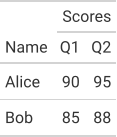
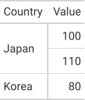

Cells that span columns (`colspan`) and rows (`rowspan`). A spanned-over position holds a placeholder cell (`is_placeholder: true`).

Each tab is the real output of `gridwell convert`, and the docs' tests check
that it still is. The Preview is the HTML writer's output as it renders on this page;
the HTML tab shows its markup without the base stylesheet (`"base_styles": false`),
which the Preview has. The ANSI tab is drawn without color (`"color": false`).


## Colspan: a spanner label

A column label row with a label spanning two columns above them.

::: {.callout-note collapse="true" appearance="simple"}
## The IR: `fixtures/minimal/colspan_basic.json`

<!-- gridwell file fixtures/minimal/colspan_basic.json -->
```json
{
  "ir_version": "1.0",

  "config": {
    "table_cols": 3,
    "header_rows": 2,
    "body_rows": 2,
    "stub_cols": 0,
    "row_striping": false,
    "row_striping_include_stub": false,
    "row_striping_include_body": false,
    "column_labels_hidden": false,
    "table_width": null,
    "container_width": null,
    "container_height": null,
    "container_overflow": null,
    "locale": "en-US",
    "page_break_mode": "avoid",
    "aria_label": null,
    "aria_describedby": null,
    "summary": null
  },

  "styles": {
    "defs": {},
    "compositions": {},
    "conditionals": []
  },

  "header": {
    "title": null,
    "subtitle": null,
    "extra_lines": [],
    "preheader_content": null
  },

  "column_spec": [
    { "id": "col_0", "align": "left", "align_char": null, "width": "auto", "min_width": null, "max_width": null, "style_id": null, "hidden": false, "label": "Name" },
    { "id": "col_1", "align": "right", "align_char": null, "width": "auto", "min_width": null, "max_width": null, "style_id": null, "hidden": false, "label": "Q1" },
    { "id": "col_2", "align": "right", "align_char": null, "width": "auto", "min_width": null, "max_width": null, "style_id": null, "hidden": false, "label": "Q2" }
  ],

  "table": {
    "thead": {
      "rows": [
        {
          "role": "spanner_label",
          "style_id": null,
          "cells": [
            {
              "content": [],
              "colspan": 1,
              "rowspan": 1,
              "style_id": null,
              "is_stub": false,
              "is_placeholder": false,
              "scope": null,
              "sort_key": null,
              "data_type": null
            },
            {
              "content": [{ "type": "text", "value": "Scores" }],
              "colspan": 2,
              "rowspan": 1,
              "style_id": null,
              "is_stub": false,
              "is_placeholder": false,
              "scope": "colgroup",
              "sort_key": null,
              "data_type": null
            },
            {
              "content": [],
              "colspan": 1,
              "rowspan": 1,
              "style_id": null,
              "is_stub": false,
              "is_placeholder": true,
              "scope": null,
              "sort_key": null,
              "data_type": null
            }
          ]
        },
        {
          "role": "column_label",
          "style_id": null,
          "cells": [
            {
              "content": [{ "type": "text", "value": "Name" }],
              "colspan": 1,
              "rowspan": 1,
              "style_id": null,
              "is_stub": false,
              "is_placeholder": false,
              "scope": "col",
              "sort_key": null,
              "data_type": "string"
            },
            {
              "content": [{ "type": "text", "value": "Q1" }],
              "colspan": 1,
              "rowspan": 1,
              "style_id": null,
              "is_stub": false,
              "is_placeholder": false,
              "scope": "col",
              "sort_key": null,
              "data_type": "number"
            },
            {
              "content": [{ "type": "text", "value": "Q2" }],
              "colspan": 1,
              "rowspan": 1,
              "style_id": null,
              "is_stub": false,
              "is_placeholder": false,
              "scope": "col",
              "sort_key": null,
              "data_type": "number"
            }
          ]
        }
      ]
    },

    "tbody": [
      {
        "group_id": null,
        "label": null,
        "rows": [
          {
            "role": null,
            "style_id": null,
            "cells": [
              {
                "content": [{ "type": "text", "value": "Alice" }],
                "typed_value": { "type": "string", "value": "Alice" },
                "colspan": 1, "rowspan": 1, "style_id": null,
                "is_stub": false, "is_placeholder": false,
                "data_type": "string", "sort_key": "alice"
              },
              {
                "content": [{ "type": "text", "value": "90" }],
                "typed_value": { "type": "number", "value": 90 },
                "colspan": 1, "rowspan": 1, "style_id": null,
                "is_stub": false, "is_placeholder": false,
                "data_type": "number", "sort_key": 90
              },
              {
                "content": [{ "type": "text", "value": "95" }],
                "typed_value": { "type": "number", "value": 95 },
                "colspan": 1, "rowspan": 1, "style_id": null,
                "is_stub": false, "is_placeholder": false,
                "data_type": "number", "sort_key": 95
              }
            ]
          },
          {
            "role": null,
            "style_id": null,
            "cells": [
              {
                "content": [{ "type": "text", "value": "Bob" }],
                "typed_value": { "type": "string", "value": "Bob" },
                "colspan": 1, "rowspan": 1, "style_id": null,
                "is_stub": false, "is_placeholder": false,
                "data_type": "string", "sort_key": "bob"
              },
              {
                "content": [{ "type": "text", "value": "85" }],
                "typed_value": { "type": "number", "value": 85 },
                "colspan": 1, "rowspan": 1, "style_id": null,
                "is_stub": false, "is_placeholder": false,
                "data_type": "number", "sort_key": 85
              },
              {
                "content": [{ "type": "text", "value": "88" }],
                "typed_value": { "type": "number", "value": 88 },
                "colspan": 1, "rowspan": 1, "style_id": null,
                "is_stub": false, "is_placeholder": false,
                "data_type": "number", "sort_key": 88
              }
            ]
          }
        ],
        "summary_rows": []
      }
    ]
  },

  "footer": { "footnotes": [], "source_notes": [] },
  "extensions": {}
}
```
:::

::: {.panel-tabset}

### Preview

<!-- gridwell convert fixtures/minimal/colspan_basic.json --to html --options '{"table_id": "colspan", "quarto_disable_processing": true}' -->
```{=html}
<div id="colspan" class="gw_container">
  <style>
    :where(#colspan.gw_container) { font-family: system-ui, 'Segoe UI', Roboto, Helvetica, Arial, sans-serif; color: #333333; font-size: 16px; line-height: normal; -webkit-font-smoothing: antialiased; -moz-osx-font-smoothing: grayscale; width: fit-content; max-width: 100%; margin-left: auto; margin-right: auto }
    :where(#colspan .gw_title:first-of-type, #colspan .gw_subtitle:first-of-type, #colspan .gw_header_line:first-of-type) { border-top: 2px solid #A8A8A8 }
    :where(#colspan .gw_title) { font-size: 125%; text-align: center; padding: 4px 5px }
    :where(#colspan .gw_subtitle) { font-size: 85%; text-align: center; padding: 3px 5px 5px }
    :where(#colspan .gw_header_line) { font-size: 85%; text-align: center; padding: 0 5px 5px }
    :where(#colspan .gw_table) { border-collapse: collapse; margin: 0; width: 100%; border-top: 2px solid #D3D3D3; border-bottom: 2px solid #D3D3D3 }
    :where(#colspan .gw_cells_top) { border-top: none }
    :where(#colspan .gw_cells_bottom) { border-bottom: none }
    :where(#colspan .gw_table td, #colspan .gw_table th) { padding: 8px 5px; border-top: 1px solid #D3D3D3 }
    :where(#colspan .gw_table th) { font-weight: inherit }
    :where(#colspan .gw_table thead th) { border-top: none; padding: 5px 5px 6px }
    :where(#colspan .gw_table thead tr) { vertical-align: bottom }
    :where(#colspan .gw_table thead) { border-bottom: 2px solid #D3D3D3 }
    :where(#colspan .gw_cells_head thead) { border-bottom: none }
    :where(#colspan .gw_cells_head thead + tbody > tr:first-child > *) { border-top: none }
    :where(#colspan .gw_rule_top) { border-top: 2px solid #D3D3D3 }
    :where(#colspan .gw_rule_bottom) { border-bottom: 2px solid #D3D3D3 }
    :where(#colspan .gw_spanner) { padding: 5px 4px 7px; background-image: linear-gradient(#D3D3D3, #D3D3D3); background-size: calc(100% - 8px) 2px; background-position: bottom center; background-repeat: no-repeat }
    :where(#colspan .gw_spanner:first-child) { padding-left: 0; background-size: calc(100% - 4px) 2px; background-position: bottom left }
    :where(#colspan .gw_spanner:last-child) { padding-right: 0; background-size: calc(100% - 4px) 2px; background-position: bottom right }
    :where(#colspan .gw_spanner:first-child:last-child) { background-size: 100% 2px }
    :where(#colspan .gw_group_label) { border-top: 2px solid #D3D3D3; border-bottom: 2px solid #D3D3D3 }
    :where(#colspan .gw_stub) { border-right: 2px solid #D3D3D3 }
    :where(#colspan tbody > tr.gw_summary:first-child > *, #colspan tr:not(.gw_summary) + tr.gw_summary > *) { border-top: 2px solid #D3D3D3 }
    :where(#colspan tbody > tr.gw_grand_summary:first-child > *, #colspan tr:not(.gw_grand_summary) + tr.gw_grand_summary > *) { border-top: 6px double #D3D3D3 }
    :where(#colspan .gw_table tbody .gw__al_right) { font-variant-numeric: tabular-nums }
    :where(#colspan .gw_footer) { border-bottom: 2px solid #A8A8A8 }
    :where(#colspan .gw_footnote, #colspan .gw_source_note) { margin: 0; font-size: 90%; padding: 4px 5px }
    :where(#colspan .gw_footnote_mark) { font-size: 75%; vertical-align: 0.4em; line-height: 0; font-style: italic }
    :where(#colspan .gw_footnote_mark a) { color: inherit; text-decoration: none }
    #colspan .gw_table .gw__al_center { text-align: center }
    #colspan .gw_table .gw__al_left { text-align: left }
    #colspan .gw_table .gw__al_right { text-align: right }
  </style>
  <table class="gw_table" data-quarto-disable-processing="true">
    <thead>
      <tr class="gw_spanners">
        <th class="gw__al_left"></th>
        <th class="gw_spanner gw__al_center" scope="colgroup" colspan="2" id="colspan-Scores">Scores</th>
      </tr>
      <tr class="gw_col_labels">
        <th class="gw_col_label gw__al_left" scope="col" id="colspan-col_0">Name</th>
        <th class="gw_col_label gw__al_right" scope="col" id="colspan-col_1">Q1</th>
        <th class="gw_col_label gw__al_right" scope="col" id="colspan-col_2">Q2</th>
      </tr>
    </thead>
    <tbody>
      <tr>
        <td headers="colspan-col_0">Alice</td>
        <td class="gw__al_right" headers="colspan-Scores colspan-col_1">90</td>
        <td class="gw__al_right" headers="colspan-Scores colspan-col_2">95</td>
      </tr>
      <tr>
        <td headers="colspan-col_0">Bob</td>
        <td class="gw__al_right" headers="colspan-Scores colspan-col_1">85</td>
        <td class="gw__al_right" headers="colspan-Scores colspan-col_2">88</td>
      </tr>
    </tbody>
  </table>
</div>
```

### HTML

<!-- gridwell convert fixtures/minimal/colspan_basic.json --to html --options '{"base_styles": false}' -->
```html
<div class="gw_container">
  <style>
    .gw_table .gw__al_center { text-align: center }
    .gw_table .gw__al_left { text-align: left }
    .gw_table .gw__al_right { text-align: right }
  </style>
  <table class="gw_table">
    <thead>
      <tr class="gw_spanners">
        <th class="gw__al_left"></th>
        <th class="gw_spanner gw__al_center" scope="colgroup" colspan="2" id="Scores">Scores</th>
      </tr>
      <tr class="gw_col_labels">
        <th class="gw_col_label gw__al_left" scope="col" id="col_0">Name</th>
        <th class="gw_col_label gw__al_right" scope="col" id="col_1">Q1</th>
        <th class="gw_col_label gw__al_right" scope="col" id="col_2">Q2</th>
      </tr>
    </thead>
    <tbody>
      <tr>
        <td headers="col_0">Alice</td>
        <td class="gw__al_right" headers="Scores col_1">90</td>
        <td class="gw__al_right" headers="Scores col_2">95</td>
      </tr>
      <tr>
        <td headers="col_0">Bob</td>
        <td class="gw__al_right" headers="Scores col_1">85</td>
        <td class="gw__al_right" headers="Scores col_2">88</td>
      </tr>
    </tbody>
  </table>
</div>
```

### LaTeX

<!-- gridwell convert fixtures/minimal/colspan_basic.json --to latex -->
```latex
\begin{tabular}{lrr}
\toprule
 & \multicolumn{2}{c}{Scores} \\
\cmidrule(lr){2-3}
Name & Q1 & Q2 \\
\midrule
Alice & 90 & 95 \\
Bob & 85 & 88 \\
\bottomrule
\end{tabular}
```

### Typst

<!-- gridwell convert fixtures/minimal/colspan_basic.json --to typst -->
```typst
#table(
  columns: (auto, auto, auto,),
  align: (left, right, right,),
  stroke: none,
  table.header(
    [],
    table.cell(colspan: 2, align: center)[#text(weight: "bold")[Scores]#place(bottom + center, dy: 5pt, line(length: 100%, stroke: 0.5pt))],
    [#text(weight: "bold")[Name]],
    [#text(weight: "bold")[Q1]],
    [#text(weight: "bold")[Q2]],
    table.hline(stroke: 0.5pt),
  ),
  [Alice],
  [90],
  [95],
  [Bob],
  [85],
  [88],
)
```

### SVG

<!-- gridwell convert fixtures/minimal/colspan_basic.json -o docs/demos/images/colspan.svg -->
{fig-alt="The table as drawn by gridwell's SVG writer"}

### ANSI

<!-- gridwell convert fixtures/minimal/colspan_basic.json --to ansi --options '{"color": false}' -->
```text
┌────────────┬─────────────────────────┐
│            │         Scores          │
│ Name       │         Q1 │         Q2 │
├────────────┼────────────┼────────────┤
│ Alice      │         90 │         95 │
│ Bob        │         85 │         88 │
└────────────┴────────────┴────────────┘
```

:::

## Rowspan: a cell spanning rows

A body cell spanning two rows.

::: {.callout-note collapse="true" appearance="simple"}
## The IR: `fixtures/minimal/rowspan_basic.json`

<!-- gridwell file fixtures/minimal/rowspan_basic.json -->
```json
{
  "ir_version": "1.0",

  "config": {
    "table_cols": 2,
    "header_rows": 1,
    "body_rows": 3,
    "stub_cols": 1,
    "row_striping": false,
    "row_striping_include_stub": false,
    "row_striping_include_body": false,
    "column_labels_hidden": false,
    "table_width": null,
    "container_width": null,
    "container_height": null,
    "container_overflow": null,
    "locale": "en-US",
    "page_break_mode": "avoid",
    "aria_label": null,
    "aria_describedby": null,
    "summary": null
  },

  "styles": {
    "defs": {},
    "compositions": {},
    "conditionals": []
  },

  "header": {
    "title": null,
    "subtitle": null,
    "extra_lines": [],
    "preheader_content": null
  },

  "column_spec": [
    { "id": "col_0", "align": "left", "align_char": null, "width": "auto", "min_width": null, "max_width": null, "style_id": null, "hidden": false, "label": "Country" },
    { "id": "col_1", "align": "right", "align_char": null, "width": "auto", "min_width": null, "max_width": null, "style_id": null, "hidden": false, "label": "Value" }
  ],

  "table": {
    "thead": {
      "rows": [
        {
          "role": "column_label",
          "style_id": null,
          "cells": [
            {
              "content": [{ "type": "text", "value": "Country" }],
              "colspan": 1, "rowspan": 1, "style_id": null,
              "is_stub": true, "is_placeholder": false,
              "scope": "col", "sort_key": null, "data_type": "string"
            },
            {
              "content": [{ "type": "text", "value": "Value" }],
              "colspan": 1, "rowspan": 1, "style_id": null,
              "is_stub": false, "is_placeholder": false,
              "scope": "col", "sort_key": null, "data_type": "number"
            }
          ]
        }
      ]
    },

    "tbody": [
      {
        "group_id": null,
        "label": null,
        "rows": [
          {
            "role": null,
            "style_id": null,
            "cells": [
              {
                "content": [{ "type": "text", "value": "Japan" }],
                "typed_value": { "type": "string", "value": "Japan" },
                "colspan": 1, "rowspan": 2,
                "style_id": null, "is_stub": true, "is_placeholder": false,
                "data_type": "string", "sort_key": "japan"
              },
              {
                "content": [{ "type": "text", "value": "100" }],
                "typed_value": { "type": "number", "value": 100 },
                "colspan": 1, "rowspan": 1,
                "style_id": null, "is_stub": false, "is_placeholder": false,
                "data_type": "number", "sort_key": 100
              }
            ]
          },
          {
            "role": null,
            "style_id": null,
            "cells": [
              {
                "content": [],
                "typed_value": null,
                "colspan": 1, "rowspan": 1,
                "style_id": null, "is_stub": true, "is_placeholder": true,
                "data_type": null, "sort_key": null
              },
              {
                "content": [{ "type": "text", "value": "110" }],
                "typed_value": { "type": "number", "value": 110 },
                "colspan": 1, "rowspan": 1,
                "style_id": null, "is_stub": false, "is_placeholder": false,
                "data_type": "number", "sort_key": 110
              }
            ]
          },
          {
            "role": null,
            "style_id": null,
            "cells": [
              {
                "content": [{ "type": "text", "value": "Korea" }],
                "typed_value": { "type": "string", "value": "Korea" },
                "colspan": 1, "rowspan": 1,
                "style_id": null, "is_stub": true, "is_placeholder": false,
                "data_type": "string", "sort_key": "korea"
              },
              {
                "content": [{ "type": "text", "value": "80" }],
                "typed_value": { "type": "number", "value": 80 },
                "colspan": 1, "rowspan": 1,
                "style_id": null, "is_stub": false, "is_placeholder": false,
                "data_type": "number", "sort_key": 80
              }
            ]
          }
        ],
        "summary_rows": []
      }
    ]
  },

  "footer": { "footnotes": [], "source_notes": [] },
  "extensions": {}
}
```
:::

::: {.panel-tabset}

### Preview

<!-- gridwell convert fixtures/minimal/rowspan_basic.json --to html --options '{"table_id": "rowspan", "quarto_disable_processing": true}' -->
```{=html}
<div id="rowspan" class="gw_container">
  <style>
    :where(#rowspan.gw_container) { font-family: system-ui, 'Segoe UI', Roboto, Helvetica, Arial, sans-serif; color: #333333; font-size: 16px; line-height: normal; -webkit-font-smoothing: antialiased; -moz-osx-font-smoothing: grayscale; width: fit-content; max-width: 100%; margin-left: auto; margin-right: auto }
    :where(#rowspan .gw_title:first-of-type, #rowspan .gw_subtitle:first-of-type, #rowspan .gw_header_line:first-of-type) { border-top: 2px solid #A8A8A8 }
    :where(#rowspan .gw_title) { font-size: 125%; text-align: center; padding: 4px 5px }
    :where(#rowspan .gw_subtitle) { font-size: 85%; text-align: center; padding: 3px 5px 5px }
    :where(#rowspan .gw_header_line) { font-size: 85%; text-align: center; padding: 0 5px 5px }
    :where(#rowspan .gw_table) { border-collapse: collapse; margin: 0; width: 100%; border-top: 2px solid #D3D3D3; border-bottom: 2px solid #D3D3D3 }
    :where(#rowspan .gw_cells_top) { border-top: none }
    :where(#rowspan .gw_cells_bottom) { border-bottom: none }
    :where(#rowspan .gw_table td, #rowspan .gw_table th) { padding: 8px 5px; border-top: 1px solid #D3D3D3 }
    :where(#rowspan .gw_table th) { font-weight: inherit }
    :where(#rowspan .gw_table thead th) { border-top: none; padding: 5px 5px 6px }
    :where(#rowspan .gw_table thead tr) { vertical-align: bottom }
    :where(#rowspan .gw_table thead) { border-bottom: 2px solid #D3D3D3 }
    :where(#rowspan .gw_cells_head thead) { border-bottom: none }
    :where(#rowspan .gw_cells_head thead + tbody > tr:first-child > *) { border-top: none }
    :where(#rowspan .gw_rule_top) { border-top: 2px solid #D3D3D3 }
    :where(#rowspan .gw_rule_bottom) { border-bottom: 2px solid #D3D3D3 }
    :where(#rowspan .gw_spanner) { padding: 5px 4px 7px; background-image: linear-gradient(#D3D3D3, #D3D3D3); background-size: calc(100% - 8px) 2px; background-position: bottom center; background-repeat: no-repeat }
    :where(#rowspan .gw_spanner:first-child) { padding-left: 0; background-size: calc(100% - 4px) 2px; background-position: bottom left }
    :where(#rowspan .gw_spanner:last-child) { padding-right: 0; background-size: calc(100% - 4px) 2px; background-position: bottom right }
    :where(#rowspan .gw_spanner:first-child:last-child) { background-size: 100% 2px }
    :where(#rowspan .gw_group_label) { border-top: 2px solid #D3D3D3; border-bottom: 2px solid #D3D3D3 }
    :where(#rowspan .gw_stub) { border-right: 2px solid #D3D3D3 }
    :where(#rowspan tbody > tr.gw_summary:first-child > *, #rowspan tr:not(.gw_summary) + tr.gw_summary > *) { border-top: 2px solid #D3D3D3 }
    :where(#rowspan tbody > tr.gw_grand_summary:first-child > *, #rowspan tr:not(.gw_grand_summary) + tr.gw_grand_summary > *) { border-top: 6px double #D3D3D3 }
    :where(#rowspan .gw_table tbody .gw__al_right) { font-variant-numeric: tabular-nums }
    :where(#rowspan .gw_footer) { border-bottom: 2px solid #A8A8A8 }
    :where(#rowspan .gw_footnote, #rowspan .gw_source_note) { margin: 0; font-size: 90%; padding: 4px 5px }
    :where(#rowspan .gw_footnote_mark) { font-size: 75%; vertical-align: 0.4em; line-height: 0; font-style: italic }
    :where(#rowspan .gw_footnote_mark a) { color: inherit; text-decoration: none }
    #rowspan .gw_table .gw__al_left { text-align: left }
    #rowspan .gw_table .gw__al_right { text-align: right }
  </style>
  <table class="gw_table" data-quarto-disable-processing="true">
    <thead>
      <tr class="gw_col_labels">
        <th class="gw_stubhead gw__al_left" scope="col" id="rowspan-Country">Country</th>
        <th class="gw_col_label gw__al_right" scope="col" id="rowspan-col_1">Value</th>
      </tr>
    </thead>
    <tbody>
      <tr>
        <th class="gw_stub gw__al_left" scope="rowgroup" rowspan="2" id="rowspan-stub-1">Japan</th>
        <td class="gw__al_right" headers="rowspan-stub-1 rowspan-col_1">100</td>
      </tr>
      <tr>
        <td class="gw__al_right" headers="rowspan-stub-1 rowspan-col_1">110</td>
      </tr>
      <tr>
        <th class="gw_stub gw__al_left" scope="row" id="rowspan-stub-3">Korea</th>
        <td class="gw__al_right" headers="rowspan-stub-3 rowspan-col_1">80</td>
      </tr>
    </tbody>
  </table>
</div>
```

### HTML

<!-- gridwell convert fixtures/minimal/rowspan_basic.json --to html --options '{"base_styles": false}' -->
```html
<div class="gw_container">
  <style>
    .gw_table .gw__al_left { text-align: left }
    .gw_table .gw__al_right { text-align: right }
  </style>
  <table class="gw_table">
    <thead>
      <tr class="gw_col_labels">
        <th class="gw_stubhead gw__al_left" scope="col" id="Country">Country</th>
        <th class="gw_col_label gw__al_right" scope="col" id="col_1">Value</th>
      </tr>
    </thead>
    <tbody>
      <tr>
        <th class="gw_stub gw__al_left" scope="rowgroup" rowspan="2" id="stub-1">Japan</th>
        <td class="gw__al_right" headers="stub-1 col_1">100</td>
      </tr>
      <tr>
        <td class="gw__al_right" headers="stub-1 col_1">110</td>
      </tr>
      <tr>
        <th class="gw_stub gw__al_left" scope="row" id="stub-3">Korea</th>
        <td class="gw__al_right" headers="stub-3 col_1">80</td>
      </tr>
    </tbody>
  </table>
</div>
```

### LaTeX

<!-- gridwell convert fixtures/minimal/rowspan_basic.json --to latex -->
```latex
\begin{tabular}{lr}
\toprule
Country & Value \\
\midrule
\multirow{2}{*}{Japan} & 100 \\
 & 110 \\
Korea & 80 \\
\bottomrule
\end{tabular}
```

### Typst

<!-- gridwell convert fixtures/minimal/rowspan_basic.json --to typst -->
```typst
#table(
  columns: (auto, auto,),
  align: (left, right,),
  stroke: none,
  table.header(
    [#text(weight: "bold")[Country]],
    [#text(weight: "bold")[Value]],
    table.hline(stroke: 0.5pt),
  ),
  table.cell(rowspan: 2)[Japan],
  [100],
  [110],
  [Korea],
  [80],
)
```

### SVG

<!-- gridwell convert fixtures/minimal/rowspan_basic.json -o docs/demos/images/rowspan.svg -->
{fig-alt="The table as drawn by gridwell's SVG writer"}

### ANSI

<!-- gridwell convert fixtures/minimal/rowspan_basic.json --to ansi --options '{"color": false}' -->
```text
┌────────────┬────────────┐
│ Country    │      Value │
├────────────┼────────────┤
│ Japan      │        100 │
│            │        110 │
│ Korea      │         80 │
└────────────┴────────────┘
```

:::
